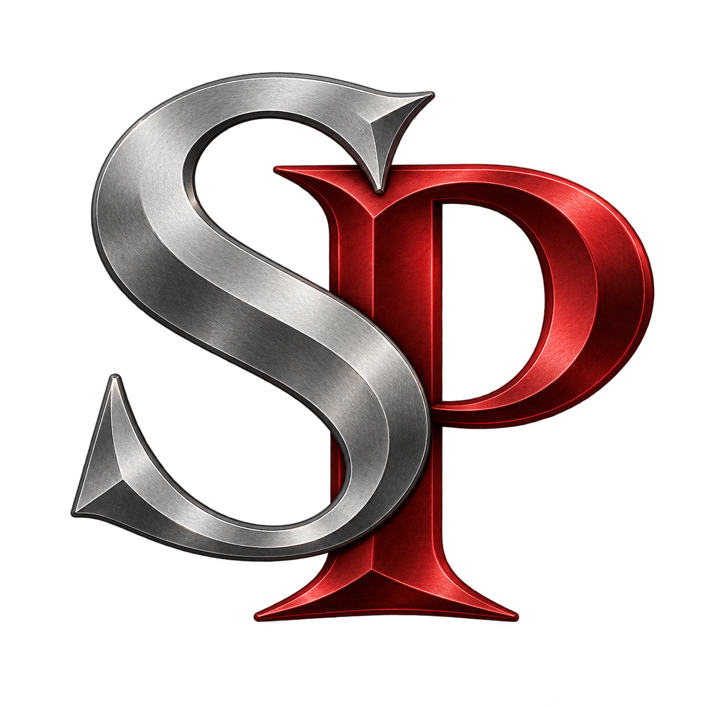
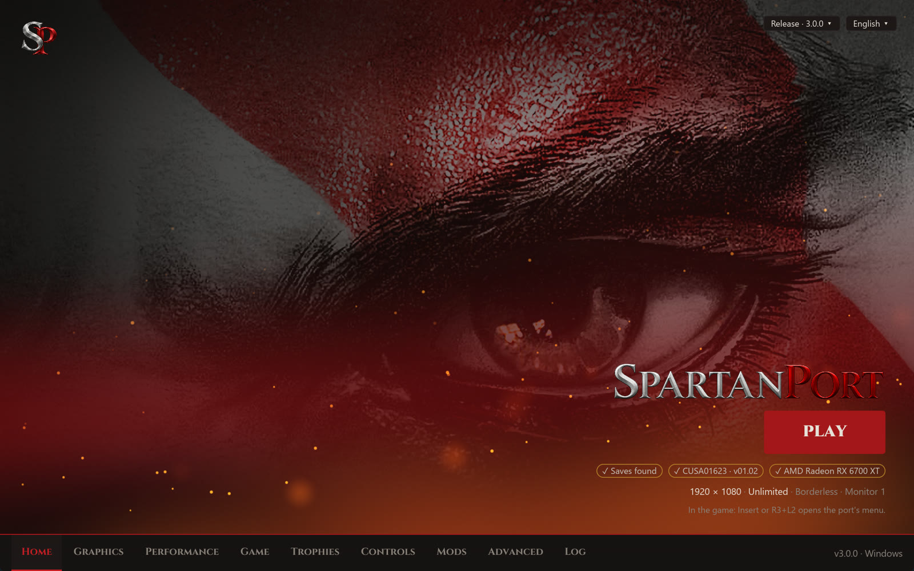
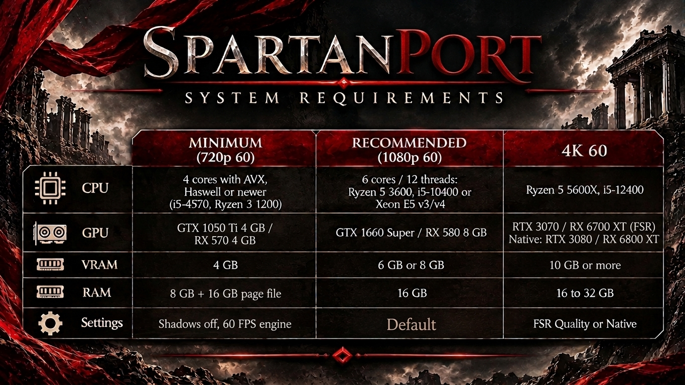

<p align="center">
  <br>
  
</p>

# SpartanPort

<div align="center">
  <a href="https://trendshift.io/repositories/299469?utm_source=trendshift-badge&amp;utm_medium=badge&amp;utm_campaign=badge-trendshift-299469" target="_blank" rel="noopener noreferrer"></a>
</div>

<p align="center">
  <a href="https://discord.gg/WYvr634563"></a>
  <a href="https://spartanport.com/es"></a>
</p>

<p align="center">
  <a href="https://github.com/FelipePrado0/SpartanPort/releases"></a>
  <a href="https://github.com/FelipePrado0/SpartanPort/releases/latest"></a>
  <a href="https://github.com/FelipePrado0/SpartanPort/stargazers"></a>
  <a href="https://github.com/FelipePrado0/SpartanPort/issues?q=is%3Aissue+is%3Aclosed"></a>
  <a href="#colaboradores"></a>
</p>

[English](https://github.com/FelipePrado0/SpartanPort/blob/main/README.md) | [Português (Brasil)](https://github.com/FelipePrado0/SpartanPort/blob/main/README.pt-BR.md) | **Español**

**SpartanPort** es un port no oficial para PC de **God of War III Remastered** (PlayStation 4) para Windows 10/11
y Linux (AppImage experimental).

> **No se incluyen archivos del juego.** Necesitás un dump de tu propia PS4 (probados: CUSA01623 y
> CUSA01715, versiones 01.00 y 01.02).
> Este proyecto no está afiliado a Sony Interactive Entertainment ni a Santa Monica Studio, ni cuenta con su respaldo.
> God of War es una marca registrada de Sony Interactive Entertainment.

<p align="center">
  
</p>

<details>
<summary><b>Actualizar desde gow3_pc (versiones anteriores a la 2.8.0)</b></summary>

Las versiones anteriores a la 2.8.0 no se migran: descargá la 2.8.0 de la
[página de releases](https://github.com/FelipePrado0/SpartanPort/releases) e instalala desde cero.
Para conservar tus partidas y ajustes en Windows, copiá estos elementos de la carpeta vieja a la
nueva, si existen: `user/`, `mods/`, `spartanport.ini`, `settings.json`, `mods.json`,
`mods_presets.json`, `patches.json` y `gamecontrollerdb.txt`. Desde la 2.5.0 o anterior, copiá
`gow3.ini` como `spartanport.ini` y sacá el `settings.json` de `%APPDATA%\gow3-launcher`.

En Linux, reemplazá el AppImage (ahora `spartanport-x86_64.AppImage`: actualizá las opciones de
lanzamiento de Steam que usan el nombre viejo del archivo). Desde la 2.5.0 o anterior, copiá
también `~/.local/share/gow3` a `~/.local/share/spartanport` (sin `user/cache` ni `out/`),
renombrá ahí el `gow3.ini` a `spartanport.ini` y copiá `~/.config/gow3-launcher/settings.json` al
lado.

Si actualizaste la 2.6.0 o la 2.7.0 desde el propio launcher, borrá `God of War III.exe` y
`_internal/` de su carpeta, y el viejo acceso directo `God of War III` del escritorio: todavía
abren el launcher viejo.

</details>

## Índice

- [SpartanPort](#spartanport)
  - [Índice](#índice)
  - [Requisitos del sistema](#requisitos-del-sistema)
  - [Descargar y jugar](#descargar-y-jugar)
  - [Linux (AppImage, experimental)](#linux-appimage-experimental)
  - [Qué funciona](#qué-funciona)
  - [Configuración](#configuración)
    - [Upscaling](#upscaling)
    - [Idioma del menú](#idioma-del-menú)
    - [Sin el launcher](#sin-el-launcher)
  - [Controles](#controles)
  - [Importar partidas de shadPS4](#importar-partidas-de-shadps4)
  - [Overlays de terceros (Windows)](#overlays-de-terceros-windows)
  - [Solución de problemas](#solución-de-problemas)
  - [Reportar un bug](#reportar-un-bug)
  - [Compilar desde el código fuente](#compilar-desde-el-código-fuente)
    - [Windows](#windows)
    - [Linux (Ubuntu 24.04)](#linux-ubuntu-2404)
    - [Launcher en Rust](#launcher-en-rust)
    - [Linux (Arch Linux)](#linux-arch-linux)
  - [Tests](#tests)
  - [Cómo contribuir](#cómo-contribuir)
  - [Cómo funciona](#cómo-funciona)
  - [Créditos](#créditos)
  - [Colaboradores](#colaboradores)
  - [Licencia](#licencia)

## Requisitos del sistema

<p align="center"></p>

| | Mínimo (720p 60) | Recomendado (1080p 60) | 4K 60 |
|---|---|---|---|
| CPU | 4 núcleos con AVX, Haswell o posterior (i5-4570, Ryzen 3 1200) | 6 núcleos / 12 hilos: Ryzen 5 3600, i5-10400 o Xeon E5 v3/v4 | Ryzen 5 5600X, i5-12400 |
| GPU | GTX 1050 Ti 4 GB / RX 570 4 GB | GTX 1660 Super / RX 580 8 GB | RTX 3070 / RX 6700 XT (FSR); nativo: RTX 3080 / RX 6800 XT |
| VRAM | 4 GB | 6 GB u 8 GB | 10 GB o más |
| RAM | 8 GB + 16 GB de archivo de paginación | 16 GB | 16 a 32 GB |
| Configuración | Sombras desactivadas, motor en 60 FPS | Predeterminada | FSR Quality o nativo |

Estos niveles son estimaciones basadas en reportes de la comunidad y en el equipo de pruebas. No
se midieron en todas las placas y no garantizan el rendimiento.

**Resultado de referencia:** una AMD Radeon RX 6700 XT, Ryzen 5 5600X y 32 GB promediaron 144 FPS
(55 a 240) en 1080p nativo con el motor en 240 FPS. El juego se jugó de principio a fin en ese
equipo.

**También se necesita**

- Windows 10 (1903 o posterior) o Windows 11, 64 bits. En Linux, glibc 2.39 o posterior (ver
  [Linux](#linux-appimage-experimental)).
- Driver de video con Vulkan 1.3, actualizado.
- CPU con AVX. Las CPU sin MOVBE, BMI1 o LZCNT (Ivy Bridge y anteriores, incluido Xeon E5 v2, y
  AMD FX) funcionan con instrucciones emuladas cuyo rendimiento todavía no se midió. Preferí
  Haswell (Xeon E5 v3) o posterior.
- Archivo de paginación en C: de 16384 MB inicial y 24576 MB máximo si el juego se cierra con
  `error 1450` (ver [Solución de problemas](#solución-de-problemas)).
- SSD para el juego y la caché de shaders. Los shaders se compilan mientras jugás y se cargan
  desde el disco en las siguientes ejecuciones.
- Tu copia del juego: CUSA01623 o CUSA01715, versión 01.00 o 01.02.

**Requisitos de funciones**

- FSR 4: AMD Radeon RX 6000 o posterior e Intel Arc (ver [Upscaling](#upscaling)).
- Generación de fotogramas: requiere un upscaler seleccionado.

**Soporte limitado**

- AMD Polaris (RX 400 y RX 500, incluida la RX 580): se investiga un cierre intermitente de
  `SurfaceFormat` ([#1181](https://github.com/FelipePrado0/SpartanPort/issues/1181)).
- Gráficos integrados Intel: se investigan cierres y errores de renderizado.
- Las placas con menos de 4 GB de VRAM pueden cerrarse con `ErrorOutOfDeviceMemory`. Bajá la
  resolución de render.

## Descargar y jugar

Necesitás una PC que cumpla los [requisitos del sistema](#requisitos-del-sistema) y tu copia del
juego (la carpeta con `eboot.bin`, `sce_module` y `sce_sys`).

**Pasos**

1. Descargá `spartanport-windows.zip` desde la
   [página de Releases](https://github.com/FelipePrado0/SpartanPort/releases/latest).
2. Extraelo en una carpeta a tu elección, por ejemplo `C:\Games\spartanport-windows`. No lo ejecutes
   desde dentro del zip.
3. Abrí **`SpartanPort.exe`**. Si Windows muestra "Windows protegió su PC", hacé clic en
   **Más información** y después en **Ejecutar de todas formas**: el programa no está firmado
   digitalmente.
4. Hacé clic en **Choose the game folder**. Te lleva a la página **Game**. Junto a **Game folder**,
   hacé clic en **Browse…** y elegí la carpeta que contiene `eboot.bin`.
5. De vuelta en **Home**, aparecen la portada y "CUSA01623 · version 01.02". Ajustá **Quick
   settings** si querés: modo de pantalla, límite de cuadros, resolución de render y tasa de
   cuadros del motor.
6. Hacé clic en **Save** para guardar los cambios pendientes y después en **PLAY**. El primer
   inicio prepara la imagen del juego; la compilación de shaders también puede afectar el
   inicio y el rendimiento en las próximas partidas.

Los parches y correcciones vienen incluidos y se aplican automáticamente: la corrección de
texturas, saltar videos con X y 120 FPS están activados por defecto. Cambiá la resolución y la tasa
de cuadros en **Home** o **Performance**.
La corrección de pantalla negra al iniciar siempre se solicita, incluso con una selección
antigua de parches guardada; cada parche se aplica solo donde coincide su firma. Un parche de
resolución reemplaza la corrección de texturas.

**Mientras jugás**

- **Insert** en el teclado, o **R3 + L2** en el control, abre el menú del port: trucos,
  multiplicadores, imagen, rendimiento y el overlay de rendimiento.
- Los shaders guardados se cargan en segundo plano. Una pequeña nota "Loading shader cache" en la
  esquina muestra el progreso.

**La próxima vez**

- **`Play SpartanPort.exe`** inicia el juego directamente con tus ajustes guardados. Podés crear
  un acceso directo en el escritorio o agregarlo a Steam con **Agregar un juego que no es de Steam**.
- Tus partidas, la caché de shaders y el log están en la carpeta `user`, junto a
  `SpartanPort.exe`. Conservá esa carpeta cuando actualices.
- **Advanced → Check for updates** descarga e instala una versión nueva. Tus partidas y ajustes se
  conservan.

## Linux (AppImage, experimental)

La build de Linux ejecuta el mismo runtime nativo y el mismo launcher. Fue probada en Arch Linux con
una Radeon RX 7800 XT (RADV) en una sesión Wayland.

**Necesitás:** Linux x86-64 con glibc 2.39 o posterior, CPU con AVX, driver Vulkan 1.3 y tu
propio dump del juego. El inicio del launcher se verifica en Ubuntu 24.04, Debian 13,
Fedora 42, Arch y openSUSE Tumbleweed; esto no comprueba gameplay en todas las GPUs.

**Descargar y ejecutar**

1. Descargá `spartanport-x86_64.AppImage` desde la
   [página de Releases](https://github.com/FelipePrado0/SpartanPort/releases/latest).
2. En la carpeta del archivo, ejecutá:
   ```bash
   chmod +x spartanport-x86_64.AppImage
   ./spartanport-x86_64.AppImage
   ```
3. Elegí la carpeta del juego, guardá los ajustes y presioná **PLAY**.

El AppImage se actualiza solo: **Advanced → Check for updates** (o el aviso al abrir el launcher)
descarga el AppImage nuevo del release, verifica su SHA-256 y reemplaza el archivo. Necesita una
carpeta con permiso de escritura; si no, abre la página de releases.

- **Archivos:** ver [dónde están los archivos](#configuración).
- **Carpeta de actualización:** si la actualización se volcó por separado del juego, elegila en
  **Game → Update folder**. Se superpone a la carpeta del juego sin modificar ninguna de las dos.
- **Advanced → Linux:** sistema de ventanas (automático, Wayland o X11), GameMode y MangoHud. Solo se
  pueden activar las herramientas instaladas en el sistema.
- **Steam:** **Advanced → Add to Steam** agrega "SpartanPort" como juego que no es de
  Steam, con el ícono, las cápsulas vertical y horizontal, el fondo de la biblioteca y el logo hechos
  a partir de las imágenes del dump. Cerrá Steam primero (reescribe sus accesos directos al salir).
  El botón también está en el launcher de Windows (aún no probado ahí).
- **Steam Deck / SteamOS (Gaming Mode):** si Steam intenta ejecutar el AppImage con Proton, abrí
  **Propiedades → Compatibilidad** del acceso directo y seleccioná **Steam Linux Runtime** en lugar de Proton.
  El AppImage es una aplicación nativa de Linux. Si no inicia con **Steam Linux Runtime**, seleccioná
  **Predeterminado** ahí para usar las bibliotecas del sistema.
- **Entrada de menú:** el AppImage escribe `~/.local/share/applications/spartanport.desktop` al iniciar,
  para que el launcher y la ventana del juego muestren su ícono en el dock; **Advanced → Linux** lo
  desactiva y elimina la entrada. Cuando otra herramienta (Gear Lever, AppImageLauncher…) ya creó una
  entrada que inicia el mismo archivo, no crea la suya y elimina la propia, sin duplicados.

## Qué funciona

| Función | Estado | Dónde / cómo activarla | Detalles |
|---|---|---|---|
| Gameplay, menús, cinemáticas | Funciona | Siempre | Videos H.264 |
| Audio | Funciona | Siempre | Música, voces y efectos (ATRAC9, MP3) |
| Control y teclado | Funciona | Game → Controls | SDL3, ambos al mismo tiempo, remapeables |
| Partidas y autoguardado | Funciona | Siempre | Lista de partidas en pantalla, como en la PS4 |
| Copias y restauración de partidas | Funciona | Game → Save backups | Una copia antes de cada inicio |
| Parches de resolución y FPS | Funciona | Home / Performance | 480p a 4K; motor a 100, 120, 144 o 240 FPS |
| Ultrawide | Beta | Render resolution | 21:9, 32:9 y 16:10; [docs/ultrawide.md](docs/ultrawide.md) |
| Upscaling (FSR 3.1, FSR 4, TAA) | Funciona | Graphics → Upscaling (desactivado) | FSR 4: RX 6000 o posterior y Arc; [Upscaling](#upscaling) |
| Generación de fotogramas (FSR 2x) | Experimental | Graphics → Upscaling (desactivada) | Requiere un upscaler |
| Compilación de shaders en segundo plano | Funciona | Performance → Shaders (activada) | Puede haber tirones la primera vez |
| Menú dentro del juego | Funciona | Insert / R3+L2 | Pestañas abajo |
| Overlay de rendimiento | Funciona | Graphics → Overlay o Insert → Overlay (desactivado) | FPS, tiempo de cuadro, GPU, CPU, RAM, VRAM |
| Trofeos | Funciona | F8 / R3+R2 | Cuatro temas de notificación; [docs/TROPHIES.es.md](docs/TROPHIES.es.md) |
| Íconos de botones en el juego | Funciona | Controls (desactivado) | Xbox, Nintendo o teclado; [docs/CONTROLS.es.md](docs/CONTROLS.es.md) |
| Cámara libre | Experimental | Controls (desactivada), G / R3 en el juego | [docs/CONTROLS.es.md](docs/CONTROLS.es.md#cámara-libre-experimental) |
| Mods | Funciona | `.zip` en la carpeta `mods` | [docs/MODS.es.md](docs/MODS.es.md) |
| Linux | Experimental | `spartanport-x86_64.AppImage` | glibc 2.39 o posterior; [Linux](#linux-appimage-experimental) |

**Pestañas del menú dentro del juego**

- **Game:** trucos (vida, magia, medidor de objeto y Furia de Esparta infinitos, máximo de orbes
  rojos, QTE automático), multiplicadores de 0,1x a 100x para orbes y daño, y una barra de vida de
  enemigos.
- **Image:** modo de pantalla, VSync y nitidez RCAS.
- **Performance:** límite de cuadros, cuadros en cola y compilación de shaders en segundo plano; la
  resolución de render, la tasa de cuadros del motor y las opciones de lectura de la GPU se aplican
  con "Apply and restart".
- **Overlay:** los elementos mostrados, tamaño de fuente, esquina, opacidad del fondo y diseño. Los
  números son el uso del propio juego, no el de todo el sistema.

El menú sigue el idioma del launcher (ver [Idioma del menú](#idioma-del-menú)).

## Configuración

**Dónde están los archivos**

| Qué | Windows | Linux |
|---|---|---|
| Ajustes del juego y del menú dentro del juego (`spartanport.ini`) | Carpeta del port | `~/.local/share/spartanport` |
| Ajustes del launcher (`settings.json`) | Carpeta del port | `~/.config/spartanport-launcher` |
| Partidas | `user\savedata\1\<ID del juego>\` | `~/.local/share/spartanport/user/savedata/1/<ID del juego>/` |
| Caché de shaders | `user\cache\` | `~/.local/share/spartanport/user/cache/` |
| Log | `user\last_run.log` y `user\last_run.jsonl` | `~/.local/share/spartanport/user/` |

La carpeta del port es la que tiene `SpartanPort.exe`; `user\` está al lado. Con una **Saves
folder** personalizada, las partidas y el log van ahí.

**Escala de la interfaz:** elegí **Auto (fits the screen)** (el valor por defecto), **1x** o
**1.5x** en **Advanced → Launcher** y hacé clic en **Save**. Los textos, controles y el diseño
cambian de tamaño juntos, sin cambiar la resolución del juego. Auto sigue la escala del escritorio
que informa el sistema de ventanas, reducida cuando hace falta para que la ventana de 1280 × 800
entre en el 90 % del monitor, y nunca por debajo de 1x. 1x y 1.5x son tamaños fijos en píxeles de
pantalla.

**Performance → GPU data** (cada opción se aplica en el próximo inicio del juego)

| Opción | Valores | Por defecto | Cuándo cambiarla |
|---|---|---|---|
| Graphics card | Automatic, o una de tus placas | Automatic | El juego corre en la placa integrada: elegí la dedicada |
| Stream buffer memory | System RAM (cached), System RAM (uncached), GPU memory | System RAM (cached) | GPU memory restaura el comportamiento anterior a esta opción; la RAM del sistema puede subir los FPS en notebooks con NVIDIA |
| Game multisampling | Automatic, Off, On | Automatic | Líneas negras en la iluminación: Off. Para mantener el multimuestreo igual: On |
| Deferred GPU readbacks | On, Off | On | Texturas o sombras incorrectas: Off (puede causar tirones) |
| GPU readbacks | Relaxed, Off, Precise | Relaxed | Solo cuando una corrección lo pida |

El multimuestreo **Automatic** usa una sola muestra en los drivers de Windows de AMD e Intel,
incluidas las integradas, donde el buffer de profundidad de 2 muestras dibujaba líneas negras en la
iluminación (familia Radeon RX 6600, Arc), y mantiene el multimuestreo en el resto (NVIDIA). La
etiqueta nombra la placa y la decisión, y la línea `GPU: guest multisampling off` u `on` del log
muestra lo que se aplicó.

### Upscaling

Elegí el upscaler y el preset de calidad en **Gráficos → Upscaling**, en el menú **Pantalla** del
juego o en el menú **Insert** (**Image**). El valor por defecto es Desactivado. El preset renderiza
una fracción de la resolución de render y el upscaler reconstruye la resolución completa; cada
preset muestra la resolución en que renderiza. Los cambios se aplican al reiniciar (**Aplicar y
reiniciar** en el juego).

| Upscaler | Placas de video | Sistemas | Notas |
|---|---|---|---|
| FSR 3.1 | Cualquier placa | Windows, Linux | Se usa en lugar de FSR 4.1 donde no está disponible |
| FSR 4 | AMD Radeon RX 6000 o posterior, Intel Arc | Windows, Linux | El modelo abierto de FSR 4, incluido |
| FSR 4.1 | AMD Radeon RX 7000 y RX 9000 (todavía no confirmado) | Windows | Necesita el runtime Vulkan del driver de AMD (`amdvkffx64.dll`, Adrenalin 26.10.1 o posterior). La RX 6000 lo tiene solo para DirectX 12 y usa FSR 3.1; el menú indica el motivo (**Insert → Image**) |
| TAA | Cualquier placa | Windows, Linux | Antialiasing a la resolución completa, sin upscaling |

La generación de fotogramas AMD FSR (2x) añade un fotograma generado entre los del juego. Activala
en **Gráficos → Upscaling** o en los menús del juego, con un escalador seleccionado. Se aplica al
instante; al desactivarla se mantiene el escalador.

### Idioma del menú

El menú Insert / R3+L2 y la ventana de trofeos (F8 / R3+R2) usan el idioma del launcher
(**Advanced → Launcher language**): inglés, portugués, español, francés, alemán, italiano, polaco,
turco, indonesio, ruso y chino. **Idioma**, arriba de la pestaña **Juego** del menú (y de la página
**Notificaciones** de la ventana de trofeos), los cambia al instante y queda guardado en
`spartanport.ini` (`ui_language`); **Igual que el launcher** vuelve a seguir al launcher. Los nombres
de los trofeos cambian con él (el launcher los escribe en todos los idiomas en `user/trophy_texts/`).
Esto no cambia el idioma del texto ni de las voces del propio juego. Árabe, japonés y coreano dejan
el menú en inglés: su fuente no los dibuja.

**Chino:** seleccioná **简体中文** en **Advanced → Launcher language**. Sin el launcher, usá
`SPARTAN_UI_LANGUAGE=zh`. El launcher prefiere una fuente CJK instalada (Microsoft YaHei UI en
Windows, Noto Sans CJK SC u otra familia CJK en los demás sistemas). El menú del juego combina una
fuente china instalada con su fuente integrada: YaHei/SimHei en Windows, las ubicaciones comunes de
Noto/WenQuanYi en Linux o PingFang en macOS. No se distribuye ninguna fuente adicional. Si no se
encuentra una fuente CJK utilizable, el menú del juego queda en inglés y registra el motivo en el
log, en lugar de mostrar cuadrados en lugar de los caracteres.

### Sin el launcher

`run.sh` y los inicios directos leen estas variables. Cuando iniciás desde el launcher, sus ajustes
guardados tienen prioridad.

| Variable | Valores | Qué define |
|---|---|---|
| `SPARTAN_GAME_DIR` | Ruta de la carpeta | La carpeta del juego para `run.sh` |
| `SPARTAN_PORT_DIR` | Ruta de la carpeta | Un port empaquetado (con `bin/`) para el launcher abierto desde un checkout |
| `SPARTAN_GPU_ID` | Número de la placa | Graphics card |
| `SPARTAN_STREAM_MEMORY` | `cached`, `host`, `device` | Stream buffer memory |
| `SPARTAN_NO_MSAA` | `1` (desactiva), `0` (activa) | Game multisampling |
| `SPARTAN_DEFERRED_READBACK` | `1`, `0` | Deferred GPU readbacks |
| `SPARTAN_UI_LANGUAGE` | Código de idioma, por ejemplo `zh` | Idioma del menú |
| `SPARTAN_KEY_MAP` | `cross=Space\|K,square=Mouse Left` | Mapeo del teclado, con teclas alternativas después de `\|` |
| `SPARTAN_SWITCH_ATTACKS` | `1` | Ataques de cambio con L1 |
| `SPARTAN_FREE_CAMERA` | `1` | Cámara libre |
| `SPARTAN_FREE_CAMERA_LIMITS` | `yaw,pitch` en grados | Cuánto gira la cámara libre |
| `SPARTAN_GLYPH_STYLE` | `auto`, `xbox`, `nintendo`, `keyboard` | Íconos de botones en el juego |

## Controles

Valores por defecto; cambialos en la página **Controls** del launcher, sección **Keyboard & Mouse Mapping**.

| Tecla | Botón |
|---|---|
| WASD | stick izquierdo |
| Flechas | stick derecho (cámara) |
| Espacio | Cruz (X) |
| Shift izquierdo | Círculo |
| Clic izquierdo | Cuadrado |
| Clic derecho | Triángulo |
| Q y E | L1 y R1 |
| R y el botón de avanzar del mouse | L2 y R2 |
| Z y X | L3 y R3 |
| F | Rage of Sparta (L3 + R3) |
| C | Agarre (L1 + Círculo) |
| El botón de retroceder del mouse | Esquivar |
| 1, 2, 3, 4 | cruceta: arriba, derecha, abajo, izquierda (armas) |
| Rueda del mouse hacia arriba y hacia abajo | arma siguiente y arma anterior (recorre las armas de la cruceta); en los menús del juego (título, pausa y Power Up) sube y baja la selección, y vuelve a las armas al caminar o esquivar |
| Tab | Options |
| P | clic del touchpad izquierdo (modo foto) |
| Esc | clic del touchpad derecho (menú de pausa) |
| Insert | el menú del port (R3+L2 en el control) |
| G | activa y desactiva la cámara libre (un toque de R3 en el control), cuando la cámara libre está activada |

Más en [docs/CONTROLS.es.md](docs/CONTROLS.es.md): giros del stick y puntería con el mouse, teclas
alternativas, controles sin touchpad, controles USB genéricos, ataques de cambio, la cámara libre y
los íconos de botones en el juego.

## Importar partidas de shadPS4

Solo son compatibles las **partidas de shadPS4 de este juego**. Las partidas de RPCS3
son del juego de PS3 y no funcionan. Usá el mismo ID de título (este ejemplo usa `CUSA01623`).

1. Cerrá el juego y shadPS4. Hacé una copia de seguridad de ambas carpetas de partidas.
2. Buscá el origen en la carpeta de datos de shadPS4: `user\savedata\1\CUSA01623\` en versiones
   anteriores, o `home\<user-id>\savedata\CUSA01623\` en versiones más nuevas.
3. El destino es **`user\savedata\1\CUSA01623\` junto a `SpartanPort.exe`**.
   Ejemplo: `C:\Games\spartanport-windows\user\savedata\1\CUSA01623\`. Con una **Saves folder**
   personalizada en el launcher, usá `<carpeta personalizada>\savedata\1\CUSA01623\`.
4. Copiá cada carpeta de slot allí, conservando su nombre y los archivos del juego. No anides otra
   carpeta `CUSA01623`. Excluí la carpeta interna `sce_sys` del slot de los datos del juego.
5. Junto a cada slot, creá `<nombre del slot>.sce_sys` si no existe. Podés copiar allí el
   `sce_sys\icon0.png` de shadPS4. **No renombres `param.sfo` a `param.bin`**: los formatos son
   distintos. Conservá cualquier `param.bin` del port que ya exista. Sin uno, el slot aparece por el
   nombre de la carpeta; al guardar de nuevo en el port se escriben sus metadatos y se actualiza la
   información mostrada.
6. Iniciá el port y elegí **Load Game**. También se pueden importar partidas completadas.

El diálogo de partidas del port muestra como máximo **32 entradas**. Si el slot importado no aparece
en una lista larga, probalo con una **Saves folder** separada que contenga solo ese slot en
`savedata\1\CUSA01623\`, con su carpeta de metadatos vecina. Conservá las partidas originales y
restaurá la configuración anterior de Saves folder después de probar.

## Overlays de terceros (Windows)

El proceso del juego es **`bin\spartanport-probe.exe`**, no `SpartanPort.exe` (las builds desde el código
fuente usan `out\spartanport-probe.exe`). Agregá ese ejecutable a RTSS y activá la visualización en pantalla
de Afterburner. En el instalador de ReShade, seleccioná ese mismo ejecutable y la API **Vulkan**.

Si el overlay sigue sin aparecer, informá las versiones del port y del overlay, la última versión del
port que funcionaba, y adjuntá `user\last_run.log`.

## Solución de problemas

Primero actualizá a la [release más reciente](https://github.com/FelipePrado0/SpartanPort/releases/latest): muchos
problemas ya están corregidos ahí. Si el tuyo no está en la lista, mirá [Reportar un bug](#reportar-un-bug).

### Mensajes de error

Abrí **Advanced → Log**, o `user\last_run.log`, y buscá el mensaje cerca del final.

| Mensaje en el log | Causa | Solución |
|---|---|---|
| `STOP: this CPU lacks` | La CPU no tiene AVX | Ninguna: el juego necesita una CPU con AVX |
| `prepare failed: expected PS4 SELF` | La carpeta elegida no es un dump preparado correctamente | Elegí la carpeta con `eboot.bin`. Si sigue fallando, extraé el PKG de nuevo o hacé un dump nuevo |
| `cannot create ... guest memory (error 1450)` o `cannot commit ... guest memory` | Windows se quedó sin memoria virtual | Aumentá el archivo de paginación (pasos abajo) |
| `ErrorOutOfDeviceMemory` (código 23) | La placa de video se quedó sin memoria, normalmente al cargar un área | Bajá la resolución de render y la **Calidad de texturas** (**Opciones → Gráficos** del juego); cerrá otros programas que usen la GPU |
| `SurfaceFormat: Unknown data_format` | Cierre conocido en AMD Polaris (RX 400, RX 500) | Actualizá el driver de AMD y adjuntá tu log en [#1181](https://github.com/FelipePrado0/SpartanPort/issues/1181) |
| `Device lost` | Cierre del driver, más común en gráficos integrados Intel | Actualizá el driver de video y reportalo con tu log |

**Archivo de paginación:** **Win + R** → `SystemPropertiesAdvanced` → configuración de
**Rendimiento** → **Opciones avanzadas** → **Memoria virtual** Cambiar, desmarcá la administración
automática, seleccioná la unidad **C:**, definí un tamaño personalizado (16384 MB inicial,
24576 MB máximo), hacé clic en **Establecer**, **Aceptar** y reiniciá la PC.

`prepare failed` también acepta archivos PS4 SELF en texto plano y ELF x86-64 little-endian
desempaquetados; los segmentos SELF cifrados o comprimidos necesitan un dump bien preparado.

### El juego no abre

- **"Windows protegió su PC":** hacé clic en **Más información** y después en **Ejecutar de todas
  formas**. El programa no está firmado digitalmente.
- **Pantalla negra al iniciar:** en una notebook con dos placas de video, elegí la dedicada en
  **Performance → Graphics card**. Si el log se corta temprano, extraé el juego de nuevo: una
  extracción defectuosa también lo causa. Borrar la caché de shaders no es una solución general y
  hace más lento el próximo inicio.
- **La ventana se cierra sin mensaje:** leé las últimas líneas de **Advanced → Log** y reportalo
  con `user/last_run.log`.

### Gráficos

- **Texturas de colores o corruptas después de un rato de juego:** la caché de texturas libera
  memoria demasiado pronto ([#1059](https://github.com/FelipePrado0/SpartanPort/issues/1059)). Reiniciar el juego lo soluciona en el momento.
  Bajá **Calidad de texturas** o la resolución de render. Desde la 3.1.0, la caché espera más en
  placas con menos de 8 GB.
- **Texturas amarillas, naranjas o blancas, o iluminación incorrecta:** desactivá **Performance →
  GPU data → Deferred GPU readbacks** y reiniciá. Puede causar tirones.
- **Líneas negras en la iluminación:** poné **Performance → GPU data → Game multisampling** en **Off**.
- **Falta el piso, Kratos cae a través del escenario o la pantalla de carga no termina:** seguidos
  en [#1133](https://github.com/FelipePrado0/SpartanPort/issues/1133) y [#1131](https://github.com/FelipePrado0/SpartanPort/issues/1131). Cargá el último checkpoint y adjuntá tu log en el issue.
- **Tirones y efectos que faltan la primera vez que ves un área:** los shaders se compilan la
  primera vez y salen de la caché en las siguientes. No borres la caché de shaders salvo que una
  corrección lo pida.
- **El overlay (RTSS, Afterburner, ReShade) no aparece:** ver
  [Overlays de terceros](#overlays-de-terceros-windows).
- **Cierre siempre en la misma escena:** reportalo con una partida guardada de antes de ese punto.

### Rendimiento

- **FPS bajos con la CPU cerca del 100%:** bajá la resolución de render. Si los FPS no cambian, el
  límite es la CPU: poné el motor en 60 FPS, cerrá programas en segundo plano y, en una notebook,
  conectala a la corriente y usá el modo de energía de máximo rendimiento. Las CPU con 4 hilos o
  menos son las más afectadas.
- **Poco uso de la GPU, o el juego corre en los gráficos integrados:** elegí la placa dedicada en
  **Performance → Graphics card**. En **Configuración → Sistema → Pantalla → Gráficos** de Windows,
  poné `bin\spartanport-probe.exe` en **Alto rendimiento**.
- **FPS bajos en una notebook con NVIDIA:** dejá **Performance → GPU data → Stream buffer memory**
  en **System RAM (cached, default)**.
- **GPU débil:** las sombras son lo que más pesa. Desactivalas en **Opciones → Gráficos** del juego.
- **La generación de fotogramas baja los FPS:** en investigación ([#1193](https://github.com/FelipePrado0/SpartanPort/issues/1193)). Desactivala
  y reportalo con un log con ella activada y otro con ella desactivada.

### Idioma y controles

- **El Idioma del juego del launcher no cambia nada:** solo se usa en el primer inicio del juego.
  Después, el juego restaura sus propios idiomas de texto y de diálogos desde su partida de ajustes,
  así que cambialos en el juego: **Opciones → Ajustes de juego → Texto del juego** y
  **Opciones → Audio → Diálogos**.
- **Un control USB genérico no se detecta:** configuralo en **Controls → Set up a controller** (ver
  [docs/CONTROLS.es.md](docs/CONTROLS.es.md#controles-usb-genéricos)).
- **Las teclas no hacen lo esperado:** usá **Reset keyboard & mouse to defaults** en la página
  Controls.

### Linux

- **`GLIBC_2.xx not found`:** el AppImage necesita glibc 2.39 o posterior. Actualizá la distribución
  o [compilá desde el código fuente](#linux-ubuntu-2404).
- **Steam abre el AppImage con Proton:** seleccioná **Steam Linux Runtime** en la compatibilidad del
  acceso directo (ver [Linux](#linux-appimage-experimental)).

## Reportar un bug

1. Actualizá a la [release más reciente](https://github.com/FelipePrado0/SpartanPort/releases/latest)
   y probá de nuevo.
2. Buscá en los [issues](https://github.com/FelipePrado0/SpartanPort/issues?q=is%3Aissue), abiertos y
   cerrados, tu mensaje de error, escena y placa de video.
3. Abrí un [issue nuevo](https://github.com/FelipePrado0/SpartanPort/issues/new/choose) con el
   formulario y adjuntá, justo después de cerrar el juego:
   - `user/last_run.log` y `user/last_run.jsonl` (también en **Advanced → Log**). Con una **Saves
     folder** personalizada, están en esa carpeta.
   - La versión del port, la placa de video y el driver, la CPU, y el ID y la versión del juego.
   - Una partida guardada de antes del problema, cuando pasa en un lugar puntual.

Para ayuda rápida, preguntá en el [Discord](https://discord.gg/WYvr634563).

## Compilar desde el código fuente

### Windows

Instalá [rustup](https://rustup.rs) (stable) y Visual Studio Build Tools con la carga "Desarrollo
para el escritorio con C++"; el launcher se compila con cargo y no necesita Python. Los comandos de
compilación siguientes usan MSYS2 CLANG64; los comandos del launcher marcados como PowerShell se
ejecutan en Windows.

1. Instalá MSYS2 (`winget install MSYS2.MSYS2`) y, en la consola **MSYS2 CLANG64**, los paquetes
   listados en [packaging/windows/README.md](https://github.com/FelipePrado0/SpartanPort/blob/main/packaging/windows/README.md).
2. Cloná el repositorio con sus submódulos y compilá:

   ```bash
   git clone --recursive https://github.com/FelipePrado0/SpartanPort
   cd SpartanPort
   bash build.sh
   ```

3. Iniciá el launcher (en PowerShell, en la carpeta del proyecto):

   ```powershell
   cd launcher-rust
   cargo run --release
   ```

4. En **Game**, elegí la carpeta del juego y los parches. Ajustá **Graphics** y **Performance**,
   hacé clic en **Save** para guardar cambios pendientes y después en **PLAY**.

Para jugar con los ajustes guardados sin abrir la ventana del launcher (para un acceso directo o
Steam):

```powershell
cd launcher-rust
cargo build --release
.\target\release\spartanport-launcher.exe --play
```

O sin los ajustes del launcher, desde Git Bash o una terminal MSYS2:

```bash
SPARTAN_GAME_DIR='D:\ruta\CUSA01623' bash run.sh
```

### Linux (Ubuntu 24.04)

Para un clon nuevo, ejecutá los comandos siguientes en una terminal Linux. El script de
dependencias instala paquetes del sistema con sudo y selecciona GCC 14 como compilador
predeterminado. El launcher necesita además [rustup](https://rustup.rs) (stable). Está destinado a
Ubuntu 24.04; adaptá las dependencias en otras distribuciones. Si ya clonaste, empezá en la carpeta
del repositorio y omití los dos primeros comandos.

```bash
git clone --recursive https://github.com/FelipePrado0/SpartanPort
cd SpartanPort
bash packaging/linux/ci-deps.sh
bash build.sh
cd launcher-rust
cargo run --release
```

Para generar un AppImage después de compilar:

```bash
bash packaging/linux/build.sh
./dist/spartanport-x86_64.AppImage
```

`packaging/linux/build.sh` compila el launcher en Rust por su cuenta. Compilar en una distribución
más nueva puede requerir una glibc más nueva; las builds públicas usan Ubuntu 24.04. En la carpeta
del repositorio, usá `bash run.sh` para iniciar directamente (compila lo que falta y ejecuta el exe
del launcher con `--run`), con `SPARTAN_GAME_DIR=/ruta/a/CUSA01623` para indicar la carpeta del
juego. Para los ajustes guardados del launcher sin la ventana, ejecutá
`launcher-rust/target/release/spartanport-launcher --play`.

### Launcher en Rust

El launcher está escrito en Rust (`launcher-rust/`, iced) y es el único que traen los paquetes.
Compila con [rustup](https://rustup.rs) (stable). En Windows, instalá Visual Studio Build Tools con
la carga "Desarrollo para el escritorio con C++"; en Ubuntu,
`sudo apt-get install build-essential pkg-config libwayland-dev libxkbcommon-dev`.

```bash
cd launcher-rust
cargo run --release
```

Abierto desde un checkout, encuentra solo las herramientas de `out/`; `SPARTAN_PORT_DIR` lo apunta
a un port empaquetado (con `bin/`). PLAY inicia el propio exe del launcher con `--run`, así que
nada necesita Python.

En macOS, `main` compila solo el launcher (PLAY todavía no tiene juego para iniciar); mirá los pasos en
[launcher-rust/README.md](launcher-rust/README.md#macos) (en inglés).

### Linux (Arch Linux)

El `PKGBUILD` está [aquí](packaging/linux/PKGBUILD).

Compilá e instalá (con [`yay`](https://github.com/jguer/yay) para la dependencia de compilación del
AUR):

```bash
sudo pacman -S --needed base-devel git curl robin-map
yay -S --needed vulkan-memory-allocator
mkdir -p ~/spartanport-build && cd ~/spartanport-build
curl -fLO https://raw.githubusercontent.com/FelipePrado0/SpartanPort/main/packaging/linux/PKGBUILD
makepkg -si
```

Abrí el launcher en **Juegos** en tu [menú de aplicaciones](https://wiki.archlinux.org/title/Desktop_entries)
o con `spartanport` en la terminal. Opcional: `sudo pacman -S --needed gamemode mangohud`.

## Tests

Ejecutá desde la raíz del repositorio después de compilar. En Windows, corré los tests C++ en la
consola MSYS2 CLANG64 después de `source ./msys2-env.sh` y agregá `.exe` a los programas de `out/`.

| Test | Comando | Sistemas | Necesita el dump |
|---|---|---|---|
| Launcher en Rust | `cd launcher-rust && cargo test` | Windows, Linux | No |
| Referencia en Python | `python -m unittest discover -s tests -p "test_*.py"` | Windows, Linux | No |
| GPU y menú | `ninja -C out/gpu perf-overlay-test warmup-inbox-test graphics-settings-test` y después ejecutá cada uno en `out/gpu/` | Windows, Linux | No |
| Runtime C | `bash build.sh --test` | Linux | No |
| Idiomas del menú | `ninja -C out/gpu ui-language-test` y después `out/gpu/ui-language-test` | Windows, Linux | No |
| Menú en chino | `ninja -C out/gpu chinese-ui-test` y después `out/gpu/chinese-ui-test` | Windows, Linux | No |
| Multiplicadores de trucos | `ninja -C out/gpu stat-multipliers-test` y después `out/gpu/stat-multipliers-test out/eboot.elf` | Windows, Linux | Sí |
| Imports del sistema | `out/spartanport-probe out/boot-linked.bin --app0 "<carpeta del juego>" --check-imports` | Windows, Linux | Sí |

- Los snapshots de las páginas en `launcher-rust/snapshots/` se comparan píxel a píxel solo en Windows.
- El código Python es la referencia congelada de la que se portó el launcher en Rust; no se
  empaqueta. `python -m unittest discover -s tests -p "test_launcher_parity_doc.py"` comprueba que
  cada test del launcher en Python tiene su fila en `docs/specs/2026-10-21-rust-launcher-parity.md`,
  y `tools/runner_fixtures.py` genera los fixtures de los tests de paridad del runner en Rust.
- `ui-language-test` comprueba que cada idioma del menú tenga todos los textos y conserve los
  argumentos de cada formato printf. `chinese-ui-test` omite sus verificaciones de caracteres, con un
  mensaje, sin una fuente CJK instalada.
- Las verificaciones que necesitan el dump usan `out/eboot.elf` y `out/boot-linked.bin` de tu juego
  preparado. `--check-imports` termina sin iniciar el gameplay.
- Hay más targets en [gpu/CMakeLists.txt](gpu/CMakeLists.txt).

## Cómo contribuir

SpartanPort lo mantienen dos personas en su tiempo libre, así que toda ayuda es bienvenida.

- **Pull requests** van a `main`. Mantené cada una con un solo cambio, contá cómo lo probaste y
  ejecutá los [tests](#tests) que lo cubren.
- **Triage de issues y revisión de PRs:** comentá en los issues abiertos con logs, duplicados y
  resultados de pruebas, o revisá las pull requests abiertas.
- **Traducciones:** los textos del launcher están en
  [launcher-rust/assets/i18n.json](launcher-rust/assets/i18n.json).
- Nunca agregues archivos del juego, dumps u otros contenidos con derechos de autor.

## Cómo funciona

La parte de la CPU es nativa: el ejecutable original del juego corre directamente en el procesador
de la PC (la PS4 usa la misma arquitectura x86-64), y un runtime escrito para este juego reemplaza
las bibliotecas del sistema de la PS4, sin emulación de CPU. Los gráficos se traducen: corren
sobre el video core de [shadPS4](https://github.com/shadps4-emu/shadPS4), que convierte los
comandos y shaders de la GPU de la PS4 a Vulkan, con las correcciones de renderizado del juego de
la [rama `eltutz` de cuesta4](https://github.com/cuesta4/shadPS4/tree/eltutz). Ejecutar el
código del juego directamente en la CPU es también como funciona shadPS4; lo que este proyecto
cambia es la capa del sistema y el trabajo específico del juego (parches, caché de shaders en
segundo plano, launcher y menú dentro del juego).
Es un fork del [port para Windows de Supermedo](https://github.com/Supermedo/bloodborne_pc) de
[bloodborne_pc de deadinside28](https://github.com/deadinside28/bloodborne_pc) (ver
[Créditos](#créditos)).

- Los parches y los hooks dentro del juego (trucos, multiplicadores, barra de vida) encuentran sus
  sitios por firma: los bytes originales alrededor de cada uno, donde sea que una versión haya
  colocado ese código (`tools/make_signatures.py`). Si no se encuentra un sitio, solo ese parche o
  hook queda desactivado; el juego inicia sin él, y el log y el menú explican por qué.

| Parte | Dónde | Qué hace |
|---|---|---|
| Preparación | `launcher-rust/src/core`, `launcher-rust/src/runner` | Lee `eboot.bin`, aplica sus relocaciones y enlaza las `libc` y `libSceFios2` propias del juego en una sola imagen |
| Loader | `src/probe.c` | Carga la imagen, instala los hooks validados (trucos, multiplicadores, barra de vida) e inicia el código original del juego |
| Runtime | `src/runtime_*.c` | Reimplementa las funciones del sistema de la PS4: memoria, hilos, archivos, audio, video, control, partidas y servicios |
| GPU | `gpu/shadps4/` | El video core de shadPS4, que traduce los comandos y shaders de la GPU de la PS4 a Vulkan, con las correcciones de cuesta4 para este juego (rama `eltutz`) y el trabajo de velocidad de este port (caché de shaders en segundo plano, lecturas diferidas) |
| Menú dentro del juego | `gpu/shim/spartanport_overlay.cpp` | El menú Dear ImGui y el overlay de rendimiento; ajustes en `gpu/shim/spartanport_settings.cpp` |
| Parches | `patches/CUSA01623.xml`, `launcher-rust/src/core` | Se aplican en memoria al iniciar, sin modificar los archivos del juego |
| Launcher | `launcher-rust/src/ui` | Ajustes, parches, mods, controles y el botón de jugar |

El Python de `scripts/` y `launcher/` se conserva como la referencia congelada de la que se portó el código Rust; ya no se distribuye.

Más documentación: [mods](docs/MODS.es.md), [parches](docs/PATCHES.es.md),
[controles](docs/CONTROLS.es.md), [mapa de cuadros e historial de investigación de escaladores](docs/upscaler.md)
y [trabajo paralelo de GPU](docs/parallel_gpu.md).

## Créditos

Este proyecto es un fork del port para Windows de Supermedo, que se basa en el original de
deadinside28:

- **deadinside28**: [bloodborne_pc](https://github.com/deadinside28/bloodborne_pc), el port nativo
  original.
- **Supermedo** (Mohammed Albarghouthi): [bloodborne_pc para Windows](https://github.com/Supermedo/bloodborne_pc),
  el fork del que proviene este proyecto.
- **cuesta4**: [fork de shadPS4 enfocado en este juego](https://github.com/cuesta4/shadPS4/tree/eltutz)
  (rama `eltutz`). El renderizado del juego en este port depende de sus correcciones: la reescritura
  del blend GNM, el estado de depth/stencil y el aliasing de imágenes. cuesta4 también es coautor de
  los parches de resolución, corrección de texturas, 120 FPS y saltar videos (abajo). Si jugás en
  shadPS4, esta es la build a usar para este juego.
- **Equipo de shadPS4**: el video core de [shadPS4](https://github.com/shadps4-emu/shadPS4), que
  hace toda la traducción de GPU y shaders a Vulkan en este port.
- **[WilkPrintes](https://github.com/WilkPrintes)**: diseñó y construyó el
  [sitio de SpartanPort](https://spartanport.com/es). Un agradecimiento especial por darle un hogar al proyecto.
- **IFreemz** (eFMann en GitHub): [shadPS4 Bloodborne DLSS & FSR](https://github.com/eFMann/shadPS4-Bloodborne-DLSS-FSR). La integración
  de los upscalers temporales en que se basan FSR 3.1 y FSR 4 de este port.

Parches: kvicken y cuesta4 (resolución, corrección de texturas, 120 FPS y saltar videos, sobre los
parches de PS3 de illusion0001), publicados para shadPS4 en
[shadps4-emu/ps4_cheats#145](https://github.com/shadps4-emu/ps4_cheats/pull/145) y adaptados a este
ejecutable. Los parches de 144 y 240 FPS fueron adaptados por Felipe Prado a partir del de 120 FPS; el de 100 FPS es
el mismo parche con 100.
Trucos: adaptados de los [GoldHEN cheats](https://github.com/GoldHEN/GoldHEN_Cheat_Repository) de
Celogamez.

También se usan: [LibAtrac9](https://github.com/Thealexbarney/LibAtrac9), [FFmpeg](https://ffmpeg.org),
[SDL3](https://github.com/libsdl-org/SDL), [Dear ImGui](https://github.com/ocornut/imgui),
[sirit](https://github.com/shadps4-emu/sirit), [magic_enum](https://github.com/Neargye/magic_enum),
[miniz](https://github.com/richgel999/miniz), [xbyak](https://github.com/herumi/xbyak),
[Vulkan Memory Allocator](https://github.com/GPUOpen-LibrariesAndSDKs/VulkanMemoryAllocator),
[FSR-Vulkan](https://github.com/FireBurn/FSR-Vulkan) y el AMD FidelityFX SDK, [Q2RTX](https://github.com/FireBurn/Q2RTX) (los archivos
del modelo abierto de FSR 4),
[MSYS2](https://www.msys2.org), [LLVM](https://llvm.org) y [Pillow](https://python-pillow.org).

## Colaboradores

<p></p>

<a href="https://github.com/FelipePrado0/SpartanPort/graphs/contributors">
  
</a>

La lista se actualiza sola. Hecho con [contrib.rocks](https://contrib.rocks).

## Licencia

GNU GPL v2 o posterior ([LICENSE](https://github.com/FelipePrado0/SpartanPort/blob/main/LICENSE)). Los componentes de terceros conservan sus propias
licencias.
