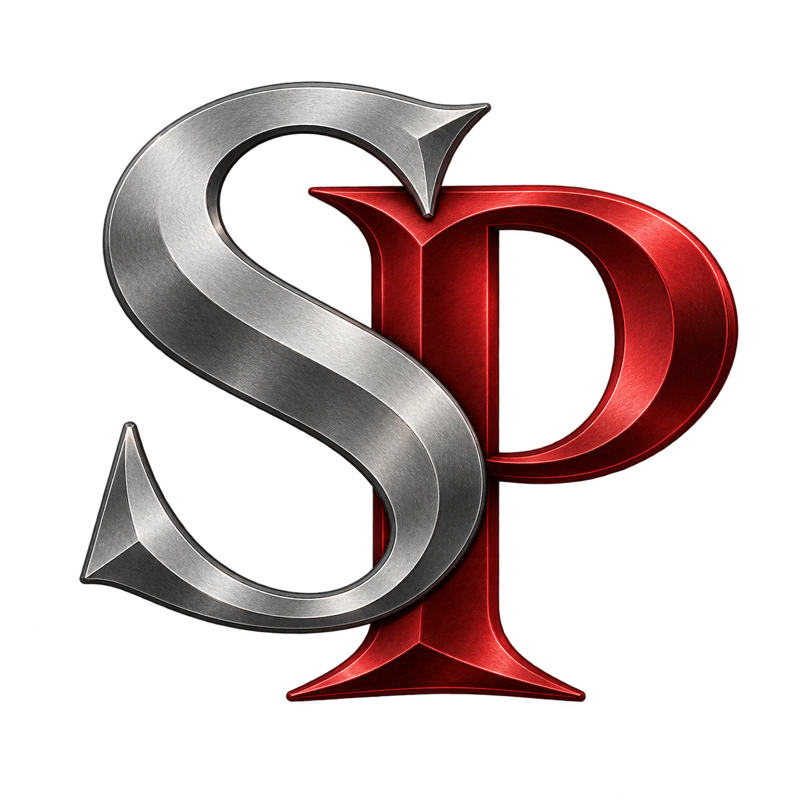
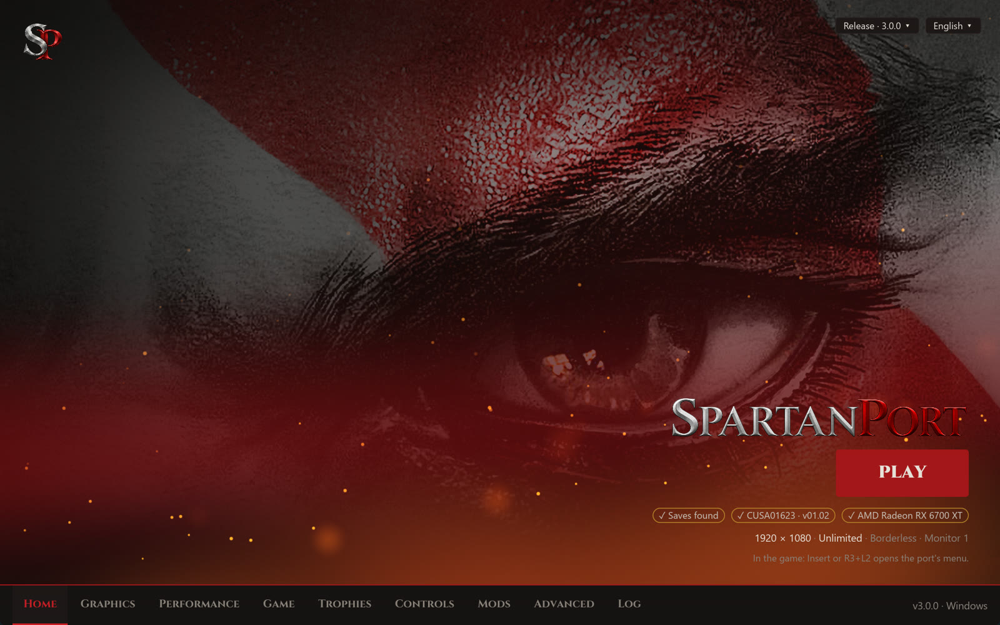
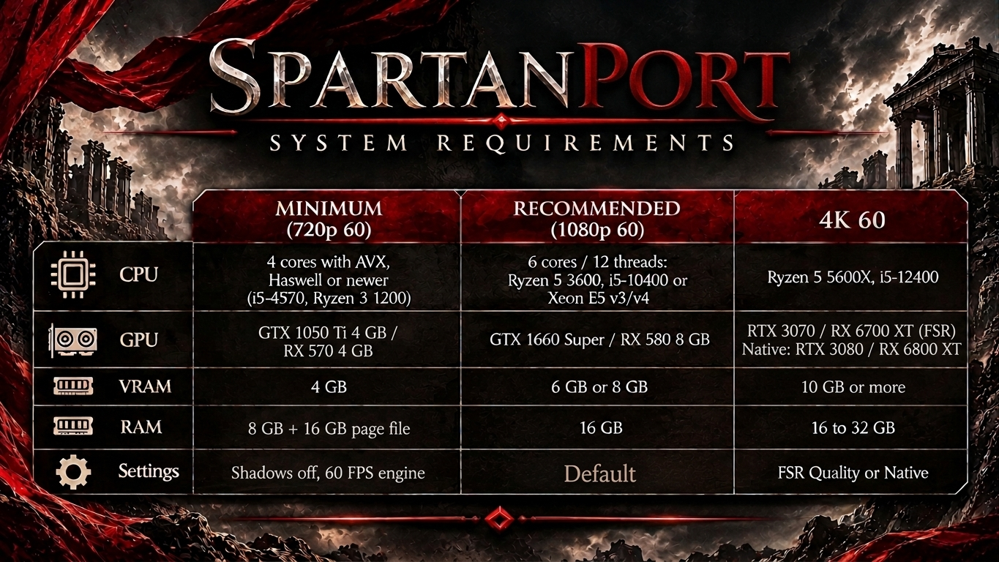

<p align="center">
  <br>
  
</p>

# SpartanPort

<div align="center">
  <a href="https://trendshift.io/repositories/299469?utm_source=trendshift-badge&amp;utm_medium=badge&amp;utm_campaign=badge-trendshift-299469" target="_blank" rel="noopener noreferrer"></a>
</div>

<p align="center">
  <a href="https://discord.gg/WYvr634563"></a>
  <a href="https://spartanport.com/en"></a>
</p>

<p align="center">
  <a href="https://github.com/FelipePrado0/SpartanPort/releases"></a>
  <a href="https://github.com/FelipePrado0/SpartanPort/releases/latest"></a>
  <a href="https://github.com/FelipePrado0/SpartanPort/stargazers"></a>
  <a href="https://github.com/FelipePrado0/SpartanPort/issues?q=is%3Aissue+is%3Aclosed"></a>
  <a href="#contributors"></a>
</p>

**English** | [Português (Brasil)](https://github.com/FelipePrado0/SpartanPort/blob/main/README.pt-BR.md) | [Español](https://github.com/FelipePrado0/SpartanPort/blob/main/README.es.md)

**SpartanPort** is an unofficial PC port of **God of War III Remastered** (PlayStation 4) for Windows 10/11
and Linux (experimental AppImage).

> **No game files are included.** You need a dump from your own PS4 (tested: CUSA01623 and
> CUSA01715, versions 01.00 and 01.02).
> This project is not affiliated with or endorsed by Sony Interactive Entertainment or Santa Monica Studio.
> God of War is a trademark of Sony Interactive Entertainment.

<p align="center">
  
</p>

<details>
<summary><b>Updating from gow3_pc (versions before 2.8.0)</b></summary>

Versions before 2.8.0 do not carry over: download 2.8.0 from the
[releases page](https://github.com/FelipePrado0/SpartanPort/releases) and install it fresh. To
keep your saves and settings on Windows, copy these from the old folder to the new one, when you
have them: `user/`, `mods/`, `spartanport.ini`, `settings.json`, `mods.json`,
`mods_presets.json`, `patches.json` and `gamecontrollerdb.txt`. From 2.5.0 or older, copy
`gow3.ini` as `spartanport.ini`, and take `settings.json` from `%APPDATA%\gow3-launcher`.

On Linux, replace the AppImage (now `spartanport-x86_64.AppImage`: update Steam launch options that
use the old file name). From 2.5.0 or older, also copy `~/.local/share/gow3` into
`~/.local/share/spartanport` (without `user/cache` and `out/`), rename `gow3.ini` there to
`spartanport.ini`, and copy `~/.config/gow3-launcher/settings.json` next to it.

If you updated 2.6.0 or 2.7.0 from inside the launcher, delete `God of War III.exe` and `_internal/`
from its folder, and the old `God of War III` desktop shortcut: they still start the old launcher.

</details>

## Contents

- [SpartanPort](#spartanport)
  - [Contents](#contents)
  - [System requirements](#system-requirements)
  - [Download and play](#download-and-play)
  - [Linux (AppImage, experimental)](#linux-appimage-experimental)
  - [What works](#what-works)
  - [Settings](#settings)
    - [Upscaling](#upscaling)
    - [Menu language](#menu-language)
    - [Without the launcher](#without-the-launcher)
  - [Controls](#controls)
  - [Importing shadPS4 saves](#importing-shadps4-saves)
  - [Third-party overlays (Windows)](#third-party-overlays-windows)
  - [Troubleshooting](#troubleshooting)
  - [Reporting a bug](#reporting-a-bug)
  - [Building from source](#building-from-source)
    - [Windows](#windows)
    - [Linux (Ubuntu 24.04)](#linux-ubuntu-2404)
    - [Rust launcher](#rust-launcher)
    - [Linux (Arch Linux)](#linux-arch-linux)
  - [Tests](#tests)
  - [Contributing](#contributing)
  - [How it works](#how-it-works)
  - [Credits](#credits)
  - [Contributors](#contributors)
  - [License](#license)

## System requirements

<p align="center"></p>

| | Minimum (720p 60) | Recommended (1080p 60) | 4K 60 |
|---|---|---|---|
| CPU | 4 cores with AVX, Haswell or newer (i5-4570, Ryzen 3 1200) | 6 cores / 12 threads: Ryzen 5 3600, i5-10400 or Xeon E5 v3/v4 | Ryzen 5 5600X, i5-12400 |
| GPU | GTX 1050 Ti 4 GB / RX 570 4 GB | GTX 1660 Super / RX 580 8 GB | RTX 3070 / RX 6700 XT (FSR); native: RTX 3080 / RX 6800 XT |
| VRAM | 4 GB | 6 GB or 8 GB | 10 GB or more |
| RAM | 8 GB + 16 GB page file | 16 GB | 16 to 32 GB |
| Settings | Shadows off, 60 FPS engine | Default | FSR Quality or native |

These tiers are estimates from community reports and the test system. They are not measured on
every card and do not guarantee performance.

**Reference result:** an AMD Radeon RX 6700 XT, Ryzen 5 5600X and 32 GB averaged 144 FPS (55 to
240) at native 1080p with the 240 FPS engine frame rate. The game was played from start to finish
on that system.

**Also needed**

- Windows 10 (1903 or newer) or Windows 11, 64-bit. On Linux, glibc 2.39 or newer (see
  [Linux](#linux-appimage-experimental)).
- A graphics driver with Vulkan 1.3, kept up to date.
- A CPU with AVX. CPUs without MOVBE, BMI1 or LZCNT (Ivy Bridge and older, including Xeon E5 v2,
  and AMD FX) run through emulated instructions whose performance has not been measured. Prefer
  Haswell (Xeon E5 v3) or newer.
- A page file on C: of 16384 MB initial and 24576 MB maximum if the game closes with
  `error 1450` (see [Troubleshooting](#troubleshooting)).
- An SSD for the game and the shader cache. Shaders compile while you play and load from disk
  on later runs.
- Your copy of the game: CUSA01623 or CUSA01715, version 01.00 or 01.02.

**Feature requirements**

- FSR 4: AMD Radeon RX 6000 or newer and Intel Arc (see [Upscaling](#upscaling)).
- Frame generation: an upscaler must be selected.

**Limited support**

- AMD Polaris (RX 400 and RX 500, including RX 580): an intermittent `SurfaceFormat` crash is
  under investigation ([#1181](https://github.com/FelipePrado0/SpartanPort/issues/1181)).
- Intel integrated graphics: crashes and rendering errors are under investigation.
- Cards with less than 4 GB of VRAM can close with `ErrorOutOfDeviceMemory`. Lower the render
  resolution.

## Download and play

You need a PC that meets the [system requirements](#system-requirements) and your copy of the game
(the folder with `eboot.bin`, `sce_module` and `sce_sys`).

**Steps**

1. Download `spartanport-windows.zip` from the
   [Releases page](https://github.com/FelipePrado0/SpartanPort/releases/latest).
2. Extract it to a folder of your choice, for example `C:\Games\spartanport-windows`. Do not run it from
   inside the zip.
3. Open **`SpartanPort.exe`**. If Windows shows "Windows protected your PC", click
   **More info**, then **Run anyway**: the program is not digitally signed.
4. Click **Choose the game folder**. It takes you to the **Game** page. Next to **Game folder**,
   click **Browse…** and select the folder with `eboot.bin`.
5. Back on **Home**, the cover art and "CUSA01623 · version 01.02" appear. Adjust **Quick
   settings** if you like: display mode, frame rate limit, render resolution and engine frame
   rate.
6. Click **Save** to keep pending changes, then **PLAY**. The first start prepares the game image;
   shader compilation can also affect startup and performance on later launches.

Patches and fixes are included and applied automatically: texture fix, skip videos with X and
120 FPS are on by default. Change the resolution and frame rate on **Home** or **Performance**.
The startup black-screen fix is always requested, even with an older saved patch selection;
patches apply only where their signatures match. A resolution patch replaces the texture fix.

**While playing**

- **Insert** on the keyboard, or **R3 + L2** on the controller, opens the port's menu: cheats,
  multipliers, image, performance and the performance overlay.
- Saved shaders load in the background. A small "Loading shader cache" note in the corner shows
  the progress.

**Next time**

- **`Play SpartanPort.exe`** starts the game straight away with your saved settings. You can
  make a desktop shortcut to it, or add it to Steam with **Add a Non-Steam Game**.
- Your saves, shader cache and log are in the `user` folder next to `SpartanPort.exe`. Keep
  that folder when you update.
- **Advanced → Check for updates** downloads and installs a new version. Your saves and settings
  are kept.

## Linux (AppImage, experimental)

The Linux build runs the same native runtime and the same launcher. It was tested on Arch Linux
with a Radeon RX 7800 XT (RADV) in a Wayland session.

**You need:** x86-64 Linux with glibc 2.39 or newer, an AVX-capable CPU, a Vulkan 1.3 driver
and your own game dump. Launcher startup is checked on Ubuntu 24.04, Debian 13, Fedora 42,
Arch and openSUSE Tumbleweed; this does not establish gameplay compatibility on every GPU.

**Download and run**

1. Download `spartanport-x86_64.AppImage` from the
   [Releases page](https://github.com/FelipePrado0/SpartanPort/releases/latest).
2. In its folder, run:
   ```bash
   chmod +x spartanport-x86_64.AppImage
   ./spartanport-x86_64.AppImage
   ```
3. Choose your game folder, save the settings and press **PLAY**.

The AppImage updates itself: **Advanced → Check for updates** (or the notice when the launcher
opens) downloads the newer AppImage from the release, checks its SHA-256 and replaces the file. It
needs a writable folder; otherwise it opens the releases page.

- **Files:** see [where the files are](#settings).
- **Update folder:** if the update was dumped apart from the game, choose it under **Game → Update
  folder**. It is laid over the game folder without changing either.
- **Advanced → Linux:** window system (automatic, Wayland or X11), GameMode and MangoHud. Only the
  tools installed on the system can be turned on.
- **Steam:** **Advanced → Add to Steam** adds "SpartanPort" as a non-Steam game, with
  the icon, the vertical and horizontal capsules, the library background and the logo made from the
  dump's pictures. Close Steam first (it rewrites its shortcuts when it exits). The button is also in
  the Windows launcher (not tested there yet).
- **Steam Deck / SteamOS (Gaming Mode):** if Steam tries to launch the AppImage with Proton, open
  the shortcut's **Properties → Compatibility** and select **Steam Linux Runtime** instead of Proton.
  The AppImage is a native Linux application. If it fails to launch using **Steam Linux Runtime**,
  select **Default** there to use the host libraries instead.
- **Menu entry:** the AppImage writes `~/.local/share/applications/spartanport.desktop` when it starts, so
  the launcher and the game window show their icon in the dock; **Advanced → Linux** turns it off and
  removes the entry. When another tool (Gear Lever, AppImageLauncher…) already made an entry that
  starts the same file, it makes none and removes its own, so there are no duplicates.

## What works

| Feature | Status | Where / how to turn it on | Details |
|---|---|---|---|
| Gameplay, menus, cutscenes | Works | Always | H.264 videos |
| Audio | Works | Always | Music, voices and effects (ATRAC9, MP3) |
| Controller and keyboard | Works | Game → Controls | SDL3, both at the same time, remappable |
| Saves and autosave | Works | Always | Save list on screen, as on the PS4 |
| Save backups and restore | Works | Game → Save backups | A backup before every start |
| Resolution and frame rate patches | Works | Home / Performance | 480p to 4K; 100, 120, 144 or 240 FPS engine |
| Ultrawide | Beta | Render resolution | 21:9, 32:9 and 16:10; [docs/ultrawide.md](docs/ultrawide.md) |
| Upscaling (FSR 3.1, FSR 4, TAA) | Works | Graphics → Upscaling (off) | FSR 4: RX 6000 or newer and Arc; [Upscaling](#upscaling) |
| Frame generation (FSR 2x) | Experimental | Graphics → Upscaling (off) | Needs an upscaler |
| Background shader compilation | Works | Performance → Shaders (on) | Stutters can still happen the first time |
| In-game menu | Works | Insert / R3+L2 | Tabs below |
| Performance overlay | Works | Graphics → Overlay or Insert → Overlay (off) | FPS, frametime, GPU, CPU, RAM, VRAM |
| Trophies | Works | F8 / R3+R2 | Four notification themes; [docs/TROPHIES.md](docs/TROPHIES.md) |
| In-game button icons | Works | Controls (off) | Xbox, Nintendo or keyboard; [docs/CONTROLS.md](docs/CONTROLS.md) |
| Free camera | Experimental | Controls (off), G / R3 in play | [docs/CONTROLS.md](docs/CONTROLS.md#free-camera-experimental) |
| Mods | Works | `.zip` in the `mods` folder | [docs/MODS.md](docs/MODS.md) |
| Linux | Experimental | `spartanport-x86_64.AppImage` | glibc 2.39 or newer; [Linux](#linux-appimage-experimental) |

**In-game menu tabs**

- **Game:** cheats (infinite health, magic, item meter and Rage of Sparta, max red orbs, automatic
  QTE), multipliers from 0.1x to 100x for orbs and damage, and an enemy health bar.
- **Image:** display mode, VSync and RCAS sharpening.
- **Performance:** frame rate limit, frames queued and background shader compiling; render
  resolution, engine frame rate and GPU readback options apply with "Apply and restart".
- **Overlay:** the items shown, font size, corner, background opacity and layout. The numbers are
  the game's own use, not the whole system's.

The menu follows the launcher's language (see [Menu language](#menu-language)).

## Settings

**Where the files are**

| What | Windows | Linux |
|---|---|---|
| Game and in-game menu settings (`spartanport.ini`) | Port folder | `~/.local/share/spartanport` |
| Launcher settings (`settings.json`) | Port folder | `~/.config/spartanport-launcher` |
| Saves | `user\savedata\1\<game ID>\` | `~/.local/share/spartanport/user/savedata/1/<game ID>/` |
| Shader cache | `user\cache\` | `~/.local/share/spartanport/user/cache/` |
| Log | `user\last_run.log` and `user\last_run.jsonl` | `~/.local/share/spartanport/user/` |

The port folder is the one with `SpartanPort.exe`; `user\` is next to it. With a custom **Saves
folder**, the saves and the log go there.

**GUI Scale:** choose **Auto (fits the screen)** (the default), **1x** or **1.5x** under
**Advanced → Launcher**, then click **Save**. Text, controls and layout resize together, without
changing game resolution. Auto follows the desktop scale the window system reports, lowered when
needed so the 1280 × 800 window fits in 90 % of the monitor, and never below 1x. 1x and 1.5x are
fixed sizes in screen pixels.

**Performance → GPU data** (each applies on the next game launch)

| Option | Values | Default | When to change it |
|---|---|---|---|
| Graphics card | Automatic, or one of your cards | Automatic | The game runs on the integrated card: choose the dedicated one |
| Stream buffer memory | System RAM (cached), System RAM (uncached), GPU memory | System RAM (cached) | GPU memory restores the behavior before this option; System RAM can raise FPS on NVIDIA laptops |
| Game multisampling | Automatic, Off, On | Automatic | Black lines in the lighting: Off. To keep multisampling anyway: On |
| Deferred GPU readbacks | On, Off | On | Textures or shadows look wrong: Off (can cause stutters) |
| GPU readbacks | Relaxed, Off, Precise | Relaxed | Only when a fix asks for it |

**Automatic** multisampling uses a single sample on AMD's and Intel's Windows drivers, integrated
cards included, where the 2-sample depth buffer drew black lines in the lighting (Radeon RX 6600
family, Arc), and keeps multisampling elsewhere (NVIDIA). Its label names the card and the
decision, and the log line `GPU: guest multisampling off` or `on` shows what was applied.

### Upscaling

Choose the upscaler and the quality preset under **Graphics → Upscaling**, in the in-game
**Display** menu or in the **Insert** menu (**Image**). Off is the default. A preset renders a
share of the render resolution and the upscaler rebuilds the full resolution; each preset shows
the size it renders at. Changes apply on restart (**Apply and Restart** in the game).

| Upscaler | Graphics cards | Systems | Notes |
|---|---|---|---|
| FSR 3.1 | Every card | Windows, Linux | Used instead of FSR 4.1 where that is not available |
| FSR 4 | AMD Radeon RX 6000 or newer, Intel Arc | Windows, Linux | The open FSR 4 model, included |
| FSR 4.1 | AMD Radeon RX 7000 and RX 9000 (not yet confirmed) | Windows | Needs the AMD driver's Vulkan runtime (`amdvkffx64.dll`, Adrenalin 26.10.1 or newer). RX 6000 has it for DirectX 12 only and uses FSR 3.1; the menu says why (**Insert → Image**) |
| TAA | Every card | Windows, Linux | Anti-aliasing at the full resolution, no upscaling |

AMD FSR frame generation (2x) adds one generated frame between game frames. Enable it under
**Graphics → Upscaling** or in the in-game menus, with an upscaler selected. It applies live;
disabling it returns to the game frames without changing the upscaler.

### Menu language

The Insert / R3+L2 menu and the trophy window (F8 / R3+R2) use the launcher's language
(**Advanced → Launcher language**) in English, Portuguese, Spanish, French, German, Italian,
Polish, Turkish, Indonesian, Russian and Chinese. **Language**, at the top of the menu's **Game**
tab (and of the trophy window's **Notifications** page), switches them at once and is kept in
`spartanport.ini` (`ui_language`); **Same as the launcher** follows the launcher again. The trophy
names change with it (the launcher writes them in every language in `user/trophy_texts/`). This
does not change the game's own text or voice language. Arabic, Japanese and Korean keep the menu
in English: its font does not draw them.

**Chinese:** select **简体中文** under **Advanced → Launcher language**. Direct launches without
the launcher can set `SPARTAN_UI_LANGUAGE=zh`. The launcher prefers an installed CJK font (Microsoft
YaHei UI on Windows, Noto Sans CJK SC or another available CJK family elsewhere). The in-game menu
merges an installed Chinese font with its embedded font: Windows YaHei/SimHei, common Linux
Noto/WenQuanYi locations, or macOS PingFang. No additional font is distributed. If no usable CJK
font is found, the in-game menu keeps English and logs the reason instead of displaying
missing-glyph boxes.

### Without the launcher

`run.sh` and direct starts read these variables. When you start through the launcher, its saved
settings win.

| Variable | Values | What it sets |
|---|---|---|
| `SPARTAN_GAME_DIR` | Folder path | The game folder for `run.sh` |
| `SPARTAN_PORT_DIR` | Folder path | A packaged port (its `bin/`) for a launcher started from a checkout |
| `SPARTAN_GPU_ID` | Card number | Graphics card |
| `SPARTAN_STREAM_MEMORY` | `cached`, `host`, `device` | Stream buffer memory |
| `SPARTAN_NO_MSAA` | `1` (off), `0` (on) | Game multisampling |
| `SPARTAN_DEFERRED_READBACK` | `1`, `0` | Deferred GPU readbacks |
| `SPARTAN_UI_LANGUAGE` | Language code, for example `zh` | Menu language |
| `SPARTAN_KEY_MAP` | `cross=Space\|K,square=Mouse Left` | Keyboard mapping, with alternative keys after `\|` |
| `SPARTAN_SWITCH_ATTACKS` | `1` | Switch attacks on L1 |
| `SPARTAN_FREE_CAMERA` | `1` | Free camera |
| `SPARTAN_FREE_CAMERA_LIMITS` | `yaw,pitch` in degrees | How far the free camera turns |
| `SPARTAN_GLYPH_STYLE` | `auto`, `xbox`, `nintendo`, `keyboard` | In-game button icons |

## Controls

Defaults; change them on the launcher's **Controls** page, under **Keyboard & Mouse Mapping**.

| Key | Button |
|---|---|
| WASD | left stick |
| Arrows | right stick (camera) |
| Space | Cross |
| Left Shift | Circle |
| Left click | Square |
| Right click | Triangle |
| Q and E | L1 and R1 |
| R and the mouse's forward button | L2 and R2 |
| Z and X | L3 and R3 |
| F | Rage of Sparta (L3 + R3) |
| C | Grab (L1 + Circle) |
| The mouse's back button | Dodge |
| 1, 2, 3, 4 | d-pad up, right, down, left (weapons) |
| Mouse wheel up and down | next and previous weapon (cycles the d-pad weapons); in the game's menus (title, pause and Power Up) it moves the selection up and down, and goes back to the weapons once you walk or dodge |
| Tab | Options |
| P | left touchpad click (photo mode) |
| Esc | right touchpad click (pause menu) |
| Insert | the port's menu (R3+L2 on the controller) |
| G | free camera off and on (a tap of R3 on the controller), when the free camera is on |

More in [docs/CONTROLS.md](docs/CONTROLS.md): joystick prompts and mouse aiming, alternative keys,
controllers without a touchpad, generic USB controllers, switch attacks, the free camera and the
in-game button icons.

## Importing shadPS4 saves

Only **shadPS4 saves of this game** are compatible. RPCS3 saves are
from the PS3 game and will not work. Use the same title ID (this example uses `CUSA01623`).

1. Close the game and shadPS4. Back up both save folders.
2. Find the source in shadPS4's data folder: `user\savedata\1\CUSA01623\` in older
   versions, or `home\<user-id>\savedata\CUSA01623\` in newer versions.
3. The destination is **`user\savedata\1\CUSA01623\` next to `SpartanPort.exe`**.
   Example: `C:\Games\spartanport-windows\user\savedata\1\CUSA01623\`. With a custom
   **Saves folder** in the launcher, use `<custom folder>\savedata\1\CUSA01623\`.
4. Copy each slot folder there, keeping its name and game files. Do not nest another
   `CUSA01623` folder. Exclude the slot's internal `sce_sys` folder from the game data.
5. Beside each slot, create `<slot name>.sce_sys` if it does not exist. You can copy
   shadPS4's `sce_sys\icon0.png` there. **Do not rename `param.sfo` to `param.bin`**:
   the formats differ. Preserve any existing port `param.bin`. Without one, the slot
   appears by folder name; saving again in the port writes its metadata and refreshes
   the displayed information.
6. Start the port and select **Load Game**. Completed saves can be imported too.

The port's save dialog displays at most **32 entries**. If the imported slot is missing
from a long list, test it with a separate **Saves folder** containing just that slot
under `savedata\1\CUSA01623\`, with its sibling metadata folder. Keep the original saves
and restore the previous Saves folder setting after testing.

## Third-party overlays (Windows)

The game process is **`bin\spartanport-probe.exe`**, not `SpartanPort.exe` (source builds
use `out\spartanport-probe.exe`). Add that executable to RTSS and enable Afterburner's on-screen
display. In the ReShade installer, select that same executable and the **Vulkan** API.

If the overlay still does not appear, report the port and overlay versions, the last
working port version, and attach `user\last_run.log`.

## Troubleshooting

Update to the [latest release](https://github.com/FelipePrado0/SpartanPort/releases/latest) first: many problems are
already fixed there. If yours is not listed, see [Reporting a bug](#reporting-a-bug).

### Error messages

Open **Advanced → Log**, or `user\last_run.log`, and look for the message near the end.

| Message in the log | Cause | Fix |
|---|---|---|
| `STOP: this CPU lacks` | The CPU has no AVX | None: the game needs a CPU with AVX |
| `prepare failed: expected PS4 SELF` | The game folder is not a correctly prepared dump | Choose the folder with `eboot.bin`. If it still fails, extract the PKG again or make a new dump |
| `cannot create ... guest memory (error 1450)` or `cannot commit ... guest memory` | Windows ran out of virtual memory | Increase the page file (steps below) |
| `ErrorOutOfDeviceMemory` (exit code 23) | The graphics card ran out of video memory, usually while loading an area | Lower the render resolution and **Texture Quality** (game's **Options → Graphics**); close other programs that use the GPU |
| `SurfaceFormat: Unknown data_format` | Known crash on AMD Polaris (RX 400, RX 500) | Update the AMD driver and add your log to [#1181](https://github.com/FelipePrado0/SpartanPort/issues/1181) |
| `Device lost` | Driver crash, mostly on Intel integrated graphics | Update the graphics driver and report it with your log |

**Page file:** press **Win + R**, type `SystemPropertiesAdvanced`, go to **Performance** Settings →
**Advanced** → **Virtual memory** Change, uncheck automatic management, select drive **C:**, set a
custom size (16384 MB initial, 24576 MB maximum), click **Set**, **OK**, and restart your PC.

`prepare failed` also accepts plaintext PS4 SELF files and unpacked little-endian x86-64 ELF files;
encrypted or compressed SELF segments need a correctly prepared dump.

### The game does not start

- **"Windows protected your PC":** click **More info**, then **Run anyway**. The program is not
  digitally signed.
- **Black screen at start:** on a laptop with two graphics cards, choose the dedicated one under
  **Performance → Graphics card**. If the log stops early, extract the game again: a broken
  extraction also causes it. Clearing the shader cache is not a general fix and makes the next
  start slower.
- **The window closes with no message:** read the last lines of **Advanced → Log** and report them
  with `user/last_run.log`.

### Graphics

- **Textures turn colorful or corrupted after playing for a while:** the texture cache frees
  memory too early ([#1059](https://github.com/FelipePrado0/SpartanPort/issues/1059)). Restarting the game clears it. Lower **Texture Quality**
  or the render resolution. Since 3.1.0 the cache waits longer on cards with less than 8 GB.
- **Yellow, orange or white textures, or wrong lighting:** turn off **Performance → GPU data →
  Deferred GPU readbacks**, then restart. This can cause stutters.
- **Black lines in the lighting:** set **Performance → GPU data → Game multisampling** to **Off**.
- **Missing floor, Kratos falls through, or a loading screen that never ends:** tracked in
  [#1133](https://github.com/FelipePrado0/SpartanPort/issues/1133) and [#1131](https://github.com/FelipePrado0/SpartanPort/issues/1131). Load the last checkpoint and add your log to the issue.
- **Stutters and missing effects the first time you see an area:** the shaders compile the first
  time and load from the cache on later runs. Do not clear the shader cache unless a fix asks for it.
- **The overlay (RTSS, Afterburner, ReShade) does not show:** see
  [Third-party overlays](#third-party-overlays-windows).
- **Crash always at the same scene:** report it with a save from before that point.

### Performance

- **Low FPS with the CPU near 100%:** lower the render resolution. If the FPS does not change, the
  CPU is the limit: set the engine frame rate to 60, close background programs and, on a laptop,
  plug it in and use the best performance power mode. CPUs with 4 threads or fewer are the most
  affected.
- **Low GPU use, or the game runs on integrated graphics:** choose the dedicated card under
  **Performance → Graphics card**. In Windows **Settings → System → Display → Graphics**, set
  `bin\spartanport-probe.exe` to **High performance**.
- **Low FPS on an NVIDIA laptop:** keep **Performance → GPU data → Stream buffer memory** on
  **System RAM (cached, default)**.
- **Weak GPU:** shadows cost the most. Turn them off in the game's **Options → Graphics**.
- **Frame generation lowers the FPS:** under investigation ([#1193](https://github.com/FelipePrado0/SpartanPort/issues/1193)). Turn it off and
  report it with one log with it on and one with it off.

### Language and controls

- **Game language in the launcher has no effect:** it is only used on the game's first start. After
  that the game restores its own text and speech languages from its settings save, so change them in
  the game: **Options → Game Settings → Game Text** and **Options → Audio → Speech**.
- **A generic USB controller is not detected:** set it up in **Controls → Set up a controller**
  (see [docs/CONTROLS.md](docs/CONTROLS.md#generic-usb-controllers)).
- **Keys do not do what you expect:** use **Reset keyboard & mouse to defaults** on the Controls
  page.

### Linux

- **`GLIBC_2.xx not found`:** the AppImage needs glibc 2.39 or newer. Update the distribution or
  [build from source](#linux-ubuntu-2404).
- **Steam starts the AppImage with Proton:** select **Steam Linux Runtime** in the shortcut's
  compatibility settings (see [Linux](#linux-appimage-experimental)).

## Reporting a bug

1. Update to the [latest release](https://github.com/FelipePrado0/SpartanPort/releases/latest) and
   try again.
2. Search the [issues](https://github.com/FelipePrado0/SpartanPort/issues?q=is%3Aissue), open and
   closed, for your error message, scene and graphics card.
3. Open a [new issue](https://github.com/FelipePrado0/SpartanPort/issues/new/choose) with the form
   and attach, right after closing the game:
   - `user/last_run.log` and `user/last_run.jsonl` (also under **Advanced → Log**). With a custom
     **Saves folder**, they are in that folder.
   - The port version, graphics card and driver, CPU, and game ID and version.
   - A save from before the problem, when it happens at one place.

For quick help, ask on the [Discord](https://discord.gg/WYvr634563).

## Building from source

### Windows

Install [rustup](https://rustup.rs) (stable) and the Visual Studio Build Tools with the "Desktop
development with C++" workload; the launcher is built with cargo and needs no Python. The build
commands below use MSYS2 CLANG64; launcher commands marked PowerShell run on Windows.

1. Install MSYS2 (`winget install MSYS2.MSYS2`) and, in the **MSYS2 CLANG64** shell, the
   packages listed in [packaging/windows/README.md](https://github.com/FelipePrado0/SpartanPort/blob/main/packaging/windows/README.md).
2. Clone the repository with its submodules and build:

   ```bash
   git clone --recursive https://github.com/FelipePrado0/SpartanPort
   cd SpartanPort
   bash build.sh
   ```

3. Start the launcher (in PowerShell, in the project folder):

   ```powershell
   cd launcher-rust
   cargo run --release
   ```

4. On **Game**, choose the game folder and patches. Adjust **Graphics** and **Performance**,
   click **Save** for pending changes, then **PLAY**.

To play with the saved settings without opening the launcher's window (for a shortcut or Steam):

```powershell
cd launcher-rust
cargo build --release
.\target\release\spartanport-launcher.exe --play
```

Or without the launcher's settings, from a Git Bash or MSYS2 shell:

```bash
SPARTAN_GAME_DIR='D:\path\CUSA01623' bash run.sh
```

### Linux (Ubuntu 24.04)

For a fresh checkout, run the following in a Linux shell. The dependency script installs system
packages using sudo and selects GCC 14 as the default compiler. The launcher also needs
[rustup](https://rustup.rs) (stable). It is intended for Ubuntu 24.04; adapt dependencies for other
distributions. If already cloned, start in the repository and skip the first two commands.

```bash
git clone --recursive https://github.com/FelipePrado0/SpartanPort
cd SpartanPort
bash packaging/linux/ci-deps.sh
bash build.sh
cd launcher-rust
cargo run --release
```

To package an AppImage after the build:

```bash
bash packaging/linux/build.sh
./dist/spartanport-x86_64.AppImage
```

`packaging/linux/build.sh` builds the Rust launcher itself. Building on a newer distribution
can require a newer glibc; public release builds use Ubuntu 24.04. From the repository, use
`bash run.sh` for a direct start (it builds what is missing and runs the launcher's exe with
`--run`), with `SPARTAN_GAME_DIR=/path/to/CUSA01623` to name the game folder. For the saved
launcher settings without the window, run `launcher-rust/target/release/spartanport-launcher --play`.

### Rust launcher

The launcher is written in Rust (`launcher-rust/`, iced) and is the only launcher the packages
ship. It builds with [rustup](https://rustup.rs) (stable). On Windows,
install the Visual Studio Build Tools with the "Desktop development with C++" workload; on Ubuntu,
`sudo apt-get install build-essential pkg-config libwayland-dev libxkbcommon-dev`.

```bash
cd launcher-rust
cargo run --release
```

Started from a checkout, it finds the tools in `out/` on its own; `SPARTAN_PORT_DIR` points it at a
packaged port instead (its `bin/`). PLAY starts the launcher's own exe with `--run`, so nothing
needs Python.

On macOS only the launcher builds from `main` (PLAY has no game to start yet); see
[launcher-rust/README.md](launcher-rust/README.md#macos) for the steps.

### Linux (Arch Linux)

The `PKGBUILD` is provided [here](packaging/linux/PKGBUILD).

Build and install (using [`yay`](https://github.com/jguer/yay) for the AUR build dependency):

```bash
sudo pacman -S --needed base-devel git curl robin-map
yay -S --needed vulkan-memory-allocator
mkdir -p ~/spartanport-build && cd ~/spartanport-build
curl -fLO https://raw.githubusercontent.com/FelipePrado0/SpartanPort/main/packaging/linux/PKGBUILD
makepkg -si
```

Run the launcher under **Games** in your [application menu](https://wiki.archlinux.org/title/Desktop_entries)
or with `spartanport` from a terminal. Optional: `sudo pacman -S --needed gamemode mangohud`.

## Tests

Run these from the repository root after the build. On Windows, run the C++ tests in the MSYS2
CLANG64 shell after `source ./msys2-env.sh`, and add `.exe` to the programs in `out/`.

| Test | Command | Systems | Needs a dump |
|---|---|---|---|
| Rust launcher | `cd launcher-rust && cargo test` | Windows, Linux | No |
| Python reference | `python -m unittest discover -s tests -p "test_*.py"` | Windows, Linux | No |
| GPU and menu | `ninja -C out/gpu perf-overlay-test warmup-inbox-test graphics-settings-test`, then run each from `out/gpu/` | Windows, Linux | No |
| C runtime | `bash build.sh --test` | Linux | No |
| Menu languages | `ninja -C out/gpu ui-language-test`, then `out/gpu/ui-language-test` | Windows, Linux | No |
| Chinese menu | `ninja -C out/gpu chinese-ui-test`, then `out/gpu/chinese-ui-test` | Windows, Linux | No |
| Cheats multipliers | `ninja -C out/gpu stat-multipliers-test`, then `out/gpu/stat-multipliers-test out/eboot.elf` | Windows, Linux | Yes |
| System imports | `out/spartanport-probe out/boot-linked.bin --app0 "<game folder>" --check-imports` | Windows, Linux | Yes |

- The page snapshots under `launcher-rust/snapshots/` are compared pixel by pixel on Windows only.
- The Python code is the frozen reference the Rust launcher was ported from; it is not packaged.
  `python -m unittest discover -s tests -p "test_launcher_parity_doc.py"` checks that every Python
  launcher test has its row in `docs/specs/2026-10-21-rust-launcher-parity.md`, and
  `tools/runner_fixtures.py` generates the fixtures for the Rust runner's parity tests.
- `ui-language-test` checks that every menu language has every text and keeps each printf
  format's arguments. `chinese-ui-test` skips its glyph checks, with a message, without an
  installed CJK font.
- The checks that need a dump use `out/eboot.elf` and `out/boot-linked.bin` from your prepared
  game. `--check-imports` exits without starting gameplay.
- More targets are listed in [gpu/CMakeLists.txt](gpu/CMakeLists.txt).

## Contributing

SpartanPort is maintained by two people in their spare time, so help is welcome.

- **Pull requests** go to `main`. Keep each one to a single change, say how you tested it and run
  the [tests](#tests) that cover it.
- **Issue triage and PR review:** comment on open issues with logs, duplicates and test results,
  or review open pull requests.
- **Translations:** the launcher texts are in
  [launcher-rust/assets/i18n.json](launcher-rust/assets/i18n.json).
- Never add game files, dumps or other copyrighted assets.

## How it works

The CPU side is native: the game's original executable runs directly on the PC's processor (the
PS4 uses the same x86-64 architecture), and a runtime written for this game replaces the PS4
system libraries, without CPU emulation. The graphics are translated: they run on the
[shadPS4](https://github.com/shadps4-emu/shadPS4) video core, which converts the PS4 GPU commands
and shaders to Vulkan, with the game's rendering fixes from
[cuesta4's `eltutz` branch](https://github.com/cuesta4/shadPS4/tree/eltutz). Running the game code
directly on the CPU is also how shadPS4 works; what this project changes is the system layer and
the game-specific work (patches, background shader cache, launcher and in-game menu).
It is a fork of [Supermedo's Windows port](https://github.com/Supermedo/bloodborne_pc) of
[deadinside28's bloodborne_pc](https://github.com/deadinside28/bloodborne_pc) (see
[Credits](#credits)).

- The patches and the in-game hooks (cheats, multipliers, health bar) find their sites by
  signature: the original bytes around each one, wherever a release placed that code
  (`tools/make_signatures.py`). A site that is not found leaves only that patch or hook off; the
  game starts without it, and the log and the menu say why.

| Part | Where | What it does |
|---|---|---|
| Preparation | `launcher-rust/src/core`, `launcher-rust/src/runner` | Reads `eboot.bin`, applies its relocations and links the game's own `libc` and `libSceFios2` into one image |
| Loader | `src/probe.c` | Loads the image, installs the validated hooks (cheats, multipliers, health bar) and starts the game's original code |
| Runtime | `src/runtime_*.c` | Reimplements the PS4 system functions: memory, threads, files, audio, video, controller, saves and services |
| GPU | `gpu/shadps4/` | The shadPS4 video core, translating the PS4 GPU commands and shaders to Vulkan, with cuesta4's fixes for this game (`eltutz` branch) and this port's speed work (background shader cache, deferred readbacks) |
| In-game menu | `gpu/shim/spartanport_overlay.cpp` | The Dear ImGui menu and performance overlay; settings in `gpu/shim/spartanport_settings.cpp` |
| Patches | `patches/CUSA01623.xml`, `launcher-rust/src/core` | Applied in memory at start, without changing the game files |
| Launcher | `launcher-rust/src/ui` | Settings, patches, mods, controls and the play button |

The Python in `scripts/` and `launcher/` is kept as the frozen reference the Rust code was ported from; it no longer ships.

More documentation: [mods](docs/MODS.md), [patches](docs/PATCHES.md), [controls](docs/CONTROLS.md),
[frame map and historical upscaler research](docs/upscaler.md) and
[parallel GPU work](docs/parallel_gpu.md).

## Credits

This project is a fork of Supermedo's Windows port, which builds on deadinside28's original:

- **deadinside28**: [bloodborne_pc](https://github.com/deadinside28/bloodborne_pc), the original
  native port.
- **Supermedo** (Mohammed Albarghouthi): [bloodborne_pc for Windows](https://github.com/Supermedo/bloodborne_pc),
  the fork this project comes from.
- **cuesta4**: [shadPS4 fork focused on this game](https://github.com/cuesta4/shadPS4/tree/eltutz)
  (branch `eltutz`). The game's rendering in this port depends on its fixes: the GNM blend
  rewrite, depth/stencil state and image aliasing. cuesta4 is also a co-author of the
  resolution, texture fix, 120 FPS and skip videos patches (below). If you play on shadPS4,
  this is the build to use for this game.
- **shadPS4 team**: the [shadPS4](https://github.com/shadps4-emu/shadPS4) video core, which does
  all the GPU and shader translation to Vulkan in this port.
- **[WilkPrintes](https://github.com/WilkPrintes)**: designed and built the
  [SpartanPort website](https://spartanport.com/en). Special thanks for giving the project its home.
- **IFreemz** (eFMann on GitHub): [shadPS4 Bloodborne DLSS & FSR](https://github.com/eFMann/shadPS4-Bloodborne-DLSS-FSR). The temporal upscaler integration this port's FSR 3.1 and FSR 4 are based on.

Patches: kvicken and cuesta4 (resolution, texture fix, 120 FPS and skip videos, building on the
PS3 patches by illusion0001), published for shadPS4 in
[shadps4-emu/ps4_cheats#145](https://github.com/shadps4-emu/ps4_cheats/pull/145) and adapted to
this executable. The 144 and 240 FPS patches were adapted by Felipe Prado from the 120 FPS patch; the 100 FPS one is
the same patch with 100.
Cheats: adapted from Celogamez's [GoldHEN cheats](https://github.com/GoldHEN/GoldHEN_Cheat_Repository).

Also used: [LibAtrac9](https://github.com/Thealexbarney/LibAtrac9), [FFmpeg](https://ffmpeg.org),
[SDL3](https://github.com/libsdl-org/SDL), [Dear ImGui](https://github.com/ocornut/imgui),
[sirit](https://github.com/shadps4-emu/sirit), [magic_enum](https://github.com/Neargye/magic_enum),
[miniz](https://github.com/richgel999/miniz), [xbyak](https://github.com/herumi/xbyak),
[Vulkan Memory Allocator](https://github.com/GPUOpen-LibrariesAndSDKs/VulkanMemoryAllocator),
[FSR-Vulkan](https://github.com/FireBurn/FSR-Vulkan) and the AMD FidelityFX SDK, [Q2RTX](https://github.com/FireBurn/Q2RTX) (the open FSR 4
model files),
[MSYS2](https://www.msys2.org), [LLVM](https://llvm.org) and [Pillow](https://python-pillow.org).

## Contributors

<p></p>

<a href="https://github.com/FelipePrado0/SpartanPort/graphs/contributors">
  
</a>

The list updates by itself. Made with [contrib.rocks](https://contrib.rocks).

## License

GNU GPL v2 or later ([LICENSE](https://github.com/FelipePrado0/SpartanPort/blob/main/LICENSE)). Third-party components keep their own licenses.
