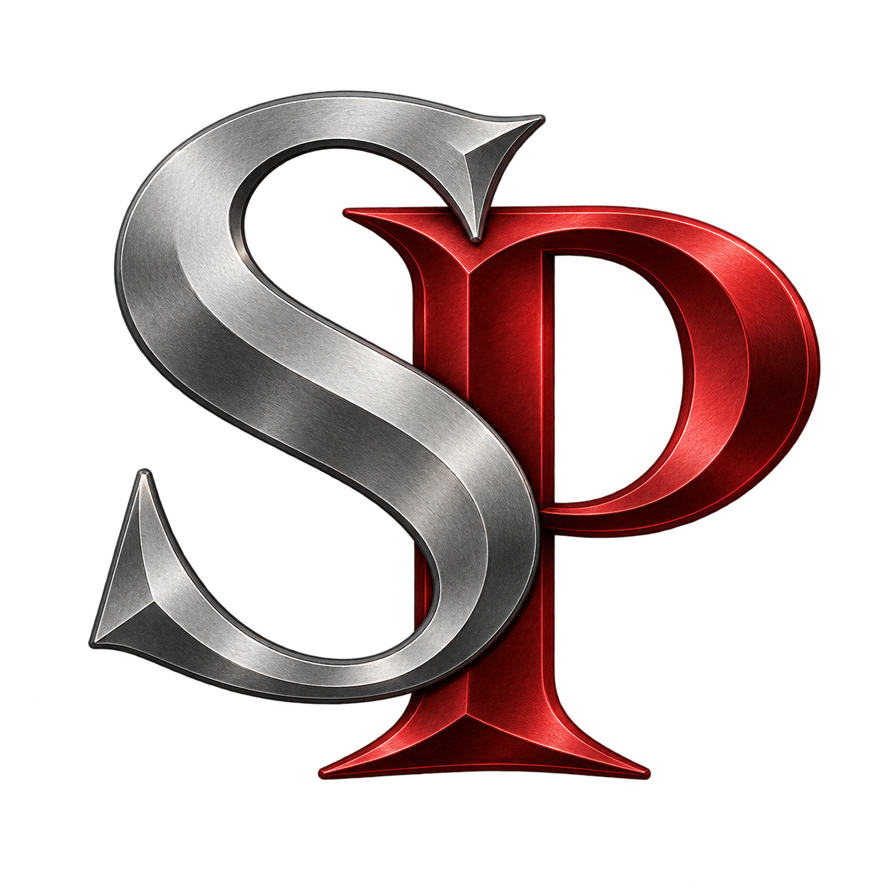
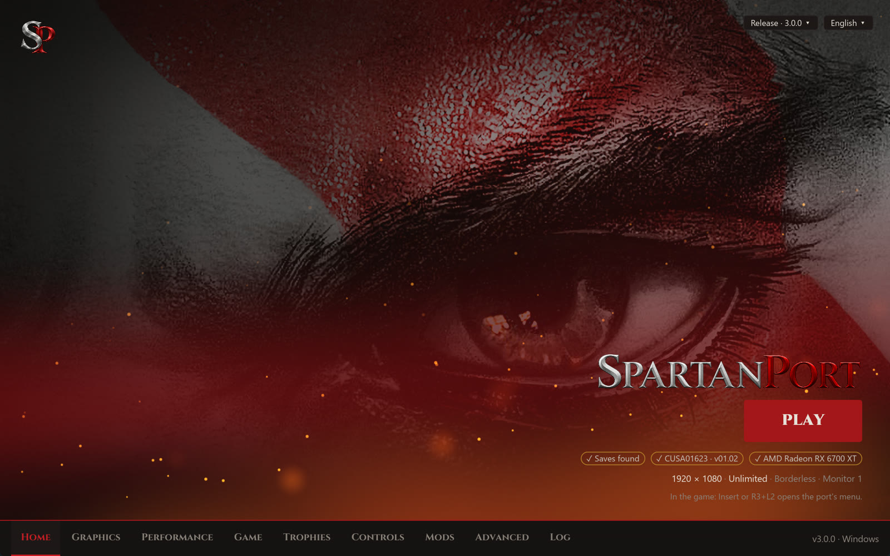
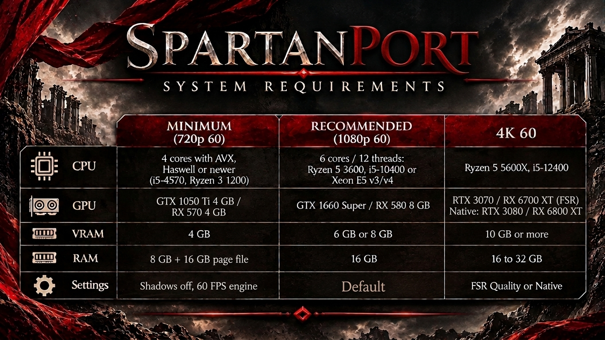

<p align="center">
  <br>
  
</p>

# SpartanPort

<div align="center">
  <a href="https://trendshift.io/repositories/299469?utm_source=trendshift-badge&amp;utm_medium=badge&amp;utm_campaign=badge-trendshift-299469" target="_blank" rel="noopener noreferrer"></a>
</div>

<p align="center">
  <a href="https://discord.gg/WYvr634563"></a>
  <a href="https://spartanport.com/pt"></a>
</p>

<p align="center">
  <a href="https://github.com/FelipePrado0/SpartanPort/releases"></a>
  <a href="https://github.com/FelipePrado0/SpartanPort/releases/latest"></a>
  <a href="https://github.com/FelipePrado0/SpartanPort/stargazers"></a>
  <a href="https://github.com/FelipePrado0/SpartanPort/issues?q=is%3Aissue+is%3Aclosed"></a>
  <a href="#contribuidores"></a>
</p>

[English](https://github.com/FelipePrado0/SpartanPort/blob/main/README.md) | **Português (Brasil)** | [Español](https://github.com/FelipePrado0/SpartanPort/blob/main/README.es.md)

**SpartanPort** é um port não oficial para PC de **God of War III Remastered** (PlayStation 4) para Windows 10/11
e Linux (AppImage experimental).

> **Nenhum arquivo do jogo está incluído.** É preciso um dump do seu próprio PS4 (testados:
> CUSA01623 e CUSA01715, versões 01.00 e 01.02). Este projeto não tem relação com a Sony Interactive Entertainment nem com o
> Santa Monica Studio, nem é endossado por elas. God of War é marca registrada da Sony Interactive Entertainment.

<p align="center">
  
</p>

<details>
<summary><b>Atualizando do gow3_pc (versões anteriores à 2.8.0)</b></summary>

As versões anteriores à 2.8.0 não são migradas: baixe a 2.8.0 na
[página de releases](https://github.com/FelipePrado0/SpartanPort/releases) e instale do zero. Para
manter seus saves e configurações no Windows, copie estes itens da pasta antiga para a nova, se
existirem: `user/`, `mods/`, `spartanport.ini`, `settings.json`, `mods.json`,
`mods_presets.json`, `patches.json` e `gamecontrollerdb.txt`. Da 2.5.0 ou anterior, copie
`gow3.ini` como `spartanport.ini` e pegue o `settings.json` em `%APPDATA%\gow3-launcher`.

No Linux, troque a AppImage (agora `spartanport-x86_64.AppImage`: atualize as opções de
inicialização da Steam que usam o nome antigo do arquivo). Da 2.5.0 ou anterior, copie também
`~/.local/share/gow3` para `~/.local/share/spartanport` (sem `user/cache` e `out/`), renomeie
lá o `gow3.ini` para `spartanport.ini` e copie `~/.config/gow3-launcher/settings.json` para o
lado dele.

Se você atualizou a 2.6.0 ou a 2.7.0 por dentro do launcher, apague `God of War III.exe` e
`_internal/` da pasta dele, e o atalho antigo `God of War III` da área de trabalho: eles ainda
abrem o launcher antigo.

</details>

## Sumário

- [SpartanPort](#spartanport)
  - [Sumário](#sumário)
  - [Requisitos de sistema](#requisitos-de-sistema)
  - [Baixar e jogar](#baixar-e-jogar)
  - [Linux (AppImage, experimental)](#linux-appimage-experimental)
  - [O que funciona](#o-que-funciona)
  - [Configurações](#configurações)
    - [Upscaling](#upscaling)
    - [Idioma do menu](#idioma-do-menu)
    - [Sem o launcher](#sem-o-launcher)
  - [Controles](#controles)
  - [Importar saves do shadPS4](#importar-saves-do-shadps4)
  - [Overlays externos (Windows)](#overlays-externos-windows)
  - [Solução de problemas](#solução-de-problemas)
  - [Relatar um bug](#relatar-um-bug)
  - [Compilar a partir do código](#compilar-a-partir-do-código)
    - [Windows](#windows)
    - [Linux (Ubuntu 24.04)](#linux-ubuntu-2404)
    - [Launcher em Rust](#launcher-em-rust)
    - [Linux (Arch Linux)](#linux-arch-linux)
  - [Testes](#testes)
  - [Como contribuir](#como-contribuir)
  - [Como funciona](#como-funciona)
  - [Créditos](#créditos)
  - [Contribuidores](#contribuidores)
  - [Licença](#licença)

## Requisitos de sistema

<p align="center"></p>

| | Mínimo (720p 60) | Recomendado (1080p 60) | 4K 60 |
|---|---|---|---|
| CPU | 4 núcleos com AVX, Haswell ou mais nova (i5-4570, Ryzen 3 1200) | 6 núcleos / 12 threads: Ryzen 5 3600, i5-10400 ou Xeon E5 v3/v4 | Ryzen 5 5600X, i5-12400 |
| GPU | GTX 1050 Ti 4 GB / RX 570 4 GB | GTX 1660 Super / RX 580 8 GB | RTX 3070 / RX 6700 XT (FSR); nativo: RTX 3080 / RX 6800 XT |
| VRAM | 4 GB | 6 GB ou 8 GB | 10 GB ou mais |
| RAM | 8 GB + 16 GB de arquivo de paginação | 16 GB | 16 a 32 GB |
| Configurações | Sombras desligadas, motor a 60 FPS | Padrão | FSR Quality ou nativo |

Esses níveis são estimativas a partir de relatos da comunidade e da máquina de teste. Não foram
medidos em todas as placas e não garantem desempenho.

**Resultado de referência:** uma AMD Radeon RX 6700 XT, Ryzen 5 5600X e 32 GB tiveram média de
144 FPS (55 a 240) em 1080p nativo com o motor a 240 FPS. O jogo foi jogado do início ao fim nessa
máquina.

**Também é preciso**

- Windows 10 (1903 ou mais novo) ou Windows 11, 64 bits. No Linux, glibc 2.39 ou mais nova (veja
  [Linux](#linux-appimage-experimental)).
- Driver de vídeo com Vulkan 1.3, atualizado.
- CPU com AVX. CPUs sem MOVBE, BMI1 ou LZCNT (Ivy Bridge e anteriores, incluindo Xeon E5 v2, e
  AMD FX) rodam com instruções emuladas, cujo desempenho ainda não foi medido. Prefira Haswell
  (Xeon E5 v3) ou mais nova.
- Arquivo de paginação no C: de 16384 MB inicial e 24576 MB máximo se o jogo fechar com
  `error 1450` (veja [Solução de problemas](#solução-de-problemas)).
- SSD para o jogo e o cache de shaders. Os shaders compilam enquanto você joga e são carregados
  do disco nas próximas vezes.
- Sua cópia do jogo: CUSA01623 ou CUSA01715, versão 01.00 ou 01.02.

**Requisitos de recursos**

- FSR 4: AMD Radeon RX 6000 ou mais nova e Intel Arc (veja [Upscaling](#upscaling)).
- Geração de quadros: exige um upscaler selecionado.

**Suporte limitado**

- AMD Polaris (RX 400 e RX 500, incluindo a RX 580): um crash intermitente de `SurfaceFormat`
  está em investigação ([#1181](https://github.com/FelipePrado0/SpartanPort/issues/1181)).
- Gráficos integrados Intel: crashes e erros de renderização estão em investigação.
- Placas com menos de 4 GB de VRAM podem fechar com `ErrorOutOfDeviceMemory`. Reduza a resolução
  de render.

## Baixar e jogar

Você precisa de um PC que atenda aos [requisitos de sistema](#requisitos-de-sistema) e da sua cópia
do jogo (a pasta com `eboot.bin`, `sce_module` e `sce_sys`).

**Passos**

1. Baixe o `spartanport-windows.zip` na
   [página de releases](https://github.com/FelipePrado0/SpartanPort/releases/latest).
2. Extraia numa pasta de sua escolha, por exemplo `C:\Jogos\spartanport-windows`. Não abra direto de
   dentro do zip.
3. Abra o **`SpartanPort.exe`**. Se o Windows mostrar "O Windows protegeu o computador",
   clique em **Mais informações** e depois em **Executar assim mesmo**: o programa não tem
   assinatura digital.
4. Clique em **Choose the game folder**. Isso leva à tela **Game**. Em **Game folder**, clique
   em **Browse…** e escolha a pasta que tem o `eboot.bin`.
5. De volta à **Home**, aparecem a capa e "CUSA01623 · version 01.02". Ajuste os **Quick
   settings** se quiser: modo de tela, limite de FPS, resolução e FPS do motor.
6. Clique em **Save** para guardar alterações pendentes e depois em **PLAY**. A primeira
   abertura prepara a imagem do jogo; a compilação de shaders também pode afetar a abertura e
   o desempenho nas próximas partidas.

Patches e correções já vêm incluídos e são aplicados sozinhos: correção de texturas, pular vídeos
com X e 120 FPS vêm ligados. Mude resolução e FPS na **Home** ou em **Performance**.
A correção da tela preta na abertura é sempre solicitada, mesmo com uma seleção antiga de
patches salva; cada patch só é aplicado onde sua assinatura corresponde. Um patch de resolução
substitui a correção de texturas.

**Durante o jogo**

- **Insert** no teclado, ou **R3 + L2** no controle, abre o menu do port: trapaças,
  multiplicadores, imagem, desempenho e o contador de desempenho.
- Os shaders salvos carregam em segundo plano. Um aviso pequeno "Loading shader cache" no canto
  mostra o progresso.

**Das próximas vezes**

- O **`Play SpartanPort.exe`** abre o jogo direto, com as configurações salvas. Dá para criar
  um atalho na área de trabalho ou adicionar à Steam em **Adicionar um jogo que não é da Steam**.
- Saves, cache de shaders e log ficam na pasta `user`, ao lado do `SpartanPort.exe`. Guarde
  essa pasta ao atualizar.
- **Advanced → Check for updates** baixa e instala a versão nova. Saves e configurações são
  mantidos.

## Linux (AppImage, experimental)

A versão para Linux usa o mesmo runtime nativo e o mesmo launcher. Foi testada no Arch Linux com uma
Radeon RX 7800 XT (RADV) numa sessão Wayland.

**Você precisa de:** Linux x86-64 com glibc 2.39 ou mais nova, CPU com AVX, driver Vulkan 1.3 e
seu próprio dump do jogo. A abertura do launcher é verificada em Ubuntu 24.04, Debian 13,
Fedora 42, Arch e openSUSE Tumbleweed; isso não comprova gameplay em todas as GPUs.

**Baixar e rodar**

1. Baixe `spartanport-x86_64.AppImage` na
   [página de releases](https://github.com/FelipePrado0/SpartanPort/releases/latest).
2. Na pasta do arquivo, execute:
   ```bash
   chmod +x spartanport-x86_64.AppImage
   ./spartanport-x86_64.AppImage
   ```
3. Escolha a pasta do jogo, salve as configurações e pressione **PLAY**.

O AppImage se atualiza sozinho: **Advanced → Check for updates** (ou o aviso ao abrir o launcher)
baixa o AppImage novo do release, confere o SHA-256 e troca o arquivo. Precisa de uma pasta com
permissão de escrita; senão abre a página de releases.

- **Arquivos:** veja [onde ficam os arquivos](#configurações).
- **Pasta do update:** se o update foi dumpado separado do jogo, escolha-a em **Jogo → Pasta do
  update**. Ela é colocada por cima da pasta do jogo sem alterar nenhuma das duas.
- **Avançado → Linux:** sistema de janelas (automático, Wayland ou X11), GameMode e MangoHud. Só as
  ferramentas instaladas no sistema podem ser ligadas.
- **Steam:** **Avançado → Adicionar à Steam** inclui "SpartanPort" como jogo de fora da
  Steam, com o ícone, as capas vertical e horizontal, o fundo da biblioteca e o logotipo feitos a
  partir das imagens do dump. Feche a Steam antes (ela reescreve os atalhos quando fecha). O botão
  também está no launcher do Windows (ainda sem teste lá).
- **Steam Deck / SteamOS (Gaming Mode):** se a Steam tentar executar o AppImage com Proton, abra
  **Propriedades → Compatibilidade** do atalho e selecione **Steam Linux Runtime** no lugar de Proton.
  O AppImage é um aplicativo nativo de Linux. Se ele não abrir com **Steam Linux Runtime**, selecione
  **Padrão** ali para usar as bibliotecas do sistema.
- **Entrada no menu:** o AppImage grava `~/.local/share/applications/spartanport.desktop` ao iniciar, para o
  launcher e a janela do jogo mostrarem o ícone no dock; **Avançado → Linux** desliga e remove a entrada.
  Quando outra ferramenta (Gear Lever, AppImageLauncher…) já criou uma entrada que inicia o mesmo
  arquivo, ele não cria a dele e remove a que tiver criado, sem duplicar.

## O que funciona

| Recurso | Status | Onde / como ligar | Detalhes |
|---|---|---|---|
| Gameplay, menus, cutscenes | Funciona | Sempre | Vídeos H.264 |
| Áudio | Funciona | Sempre | Música, vozes e efeitos (ATRAC9, MP3) |
| Controle e teclado | Funciona | Game → Controls | SDL3, os dois ao mesmo tempo, configuráveis |
| Saves e autosave | Funciona | Sempre | Lista de saves na tela, como no PS4 |
| Backup e restauração de saves | Funciona | Game → Save backups | Um backup antes de cada partida |
| Patches de resolução e FPS | Funciona | Home / Performance | 480p a 4K; motor a 100, 120, 144 ou 240 FPS |
| Ultrawide | Beta | Render resolution | 21:9, 32:9 e 16:10; [docs/ultrawide.md](docs/ultrawide.md) |
| Upscaling (FSR 3.1, FSR 4, TAA) | Funciona | Graphics → Upscaling (desligado) | FSR 4: RX 6000 ou mais nova e Arc; [Upscaling](#upscaling) |
| Geração de quadros (FSR 2x) | Experimental | Graphics → Upscaling (desligada) | Exige um upscaler |
| Compilação de shaders em segundo plano | Funciona | Performance → Shaders (ligada) | Ainda pode travar na primeira vez |
| Menu no jogo | Funciona | Insert / R3+L2 | Abas abaixo |
| Contador de desempenho | Funciona | Graphics → Overlay ou Insert → Overlay (desligado) | FPS, tempo de quadro, GPU, CPU, RAM, VRAM |
| Troféus | Funciona | F8 / R3+R2 | Quatro temas de notificação; [docs/TROPHIES.pt-BR.md](docs/TROPHIES.pt-BR.md) |
| Ícones de botões no jogo | Funciona | Controls (desligado) | Xbox, Nintendo ou teclado; [docs/CONTROLS.pt-BR.md](docs/CONTROLS.pt-BR.md) |
| Câmera livre | Experimental | Controls (desligada), G / R3 no jogo | [docs/CONTROLS.pt-BR.md](docs/CONTROLS.pt-BR.md#câmera-livre-experimental) |
| Mods | Funciona | `.zip` na pasta `mods` | [docs/MODS.pt-BR.md](docs/MODS.pt-BR.md) |
| Linux | Experimental | `spartanport-x86_64.AppImage` | glibc 2.39 ou mais nova; [Linux](#linux-appimage-experimental) |

**Abas do menu no jogo**

- **Game:** trapaças (vida, magia, item e Fúria de Esparta infinitos, orbes vermelhos no máximo,
  QTE automático), multiplicadores de 0,1x a 100x para orbes e dano, e barra de vida do inimigo.
- **Image:** modo de tela, VSync e nitidez RCAS.
- **Performance:** limite de FPS, quadros na fila e compilação de shaders em segundo plano;
  resolução, FPS do motor e as opções de leitura da GPU valem com "Apply and restart".
- **Overlay:** os itens mostrados, tamanho da fonte, canto, transparência e formato. Os números são
  o uso do próprio jogo, não do sistema inteiro.

O menu segue o idioma do launcher (veja [Idioma do menu](#idioma-do-menu)).

## Configurações

**Onde ficam os arquivos**

| O quê | Windows | Linux |
|---|---|---|
| Configurações do jogo e do menu do jogo (`spartanport.ini`) | Pasta do port | `~/.local/share/spartanport` |
| Configurações do launcher (`settings.json`) | Pasta do port | `~/.config/spartanport-launcher` |
| Saves | `user\savedata\1\<ID do jogo>\` | `~/.local/share/spartanport/user/savedata/1/<ID do jogo>/` |
| Cache de shaders | `user\cache\` | `~/.local/share/spartanport/user/cache/` |
| Log | `user\last_run.log` e `user\last_run.jsonl` | `~/.local/share/spartanport/user/` |

A pasta do port é a que tem o `SpartanPort.exe`; a `user\` fica ao lado dele. Com uma **Saves
folder** personalizada, os saves e o log vão para ela.

**Escala da interface:** escolha **Auto (fits the screen)** (o padrão), **1x** ou **1.5x** em
**Advanced → Launcher** e clique em **Save**. Textos, controles e layout mudam de tamanho juntos,
sem mudar a resolução do jogo. O Auto segue a escala da área de trabalho informada pelo sistema de
janelas, reduzida quando preciso para a janela de 1280 × 800 caber em 90 % do monitor, e nunca
abaixo de 1x. 1x e 1.5x são tamanhos fixos em pixels de tela.

**Performance → GPU data** (cada opção vale na próxima abertura do jogo)

| Opção | Valores | Padrão | Quando mudar |
|---|---|---|---|
| Graphics card | Automatic, ou uma das suas placas | Automatic | O jogo roda na placa integrada: escolha a dedicada |
| Stream buffer memory | System RAM (cached), System RAM (uncached), GPU memory | System RAM (cached) | GPU memory volta ao comportamento de antes desta opção; a RAM do sistema pode aumentar o FPS em notebooks com NVIDIA |
| Game multisampling | Automatic, Off, On | Automatic | Linhas pretas na iluminação: Off. Para manter a multiamostragem mesmo assim: On |
| Deferred GPU readbacks | On, Off | On | Texturas ou sombras erradas: Off (pode causar travadas) |
| GPU readbacks | Relaxed, Off, Precise | Relaxed | Só quando uma correção pedir |

A multiamostragem **Automatic** usa uma única amostra nos drivers de Windows da AMD e da Intel,
inclusive em placas integradas, onde o buffer de profundidade de duas amostras desenhava linhas
pretas na iluminação (família RX 6600 e Arc), e mantém a multiamostragem nos outros (NVIDIA). O
rótulo mostra a placa e a decisão, e a linha `GPU: guest multisampling off` ou `on` no log mostra
o que foi aplicado.

### Upscaling

Escolha o upscaler e o preset de qualidade em **Gráficos → Upscaling**, no menu **Exibição** do
jogo ou no menu **Insert** (**Image**). O padrão é Desligado. O preset renderiza uma fração da
resolução de render, e o upscaler reconstrói a resolução completa; cada preset mostra a resolução
em que renderiza. As mudanças valem ao reiniciar (**Aplicar e reiniciar** no jogo).

| Upscaler | Placas de vídeo | Sistemas | Observações |
|---|---|---|---|
| FSR 3.1 | Qualquer placa | Windows, Linux | Usado no lugar do FSR 4.1 onde ele não está disponível |
| FSR 4 | AMD Radeon RX 6000 ou mais nova, Intel Arc | Windows, Linux | O modelo aberto do FSR 4, incluso |
| FSR 4.1 | AMD Radeon RX 7000 e RX 9000 (ainda não confirmado) | Windows | Precisa do runtime Vulkan do driver da AMD (`amdvkffx64.dll`, Adrenalin 26.10.1 ou mais recente). A RX 6000 só tem para DirectX 12 e usa o FSR 3.1; o menu mostra o motivo (**Insert → Image**) |
| TAA | Qualquer placa | Windows, Linux | Antisserrilhamento na resolução completa, sem upscaling |

A geração de quadros AMD FSR (2x) adiciona um quadro gerado entre os quadros do jogo. Ative em
**Gráficos → Upscaling** ou nos menus do jogo, com um upscaler selecionado. A opção é aplicada na
hora; desligá-la mantém o upscaler e volta aos quadros do jogo.

### Idioma do menu

O menu Insert / R3+L2 e a janela de troféus (F8 / R3+R2) usam o idioma do launcher
(**Advanced → Launcher language**): inglês, português, espanhol, francês, alemão, italiano,
polonês, turco, indonésio, russo e chinês. **Idioma**, no topo da aba **Jogo** do menu (e da página
**Notificações** da janela de troféus), troca os dois na hora e fica salvo em `spartanport.ini`
(`ui_language`); **Igual ao launcher** volta a seguir o launcher. Os nomes dos troféus mudam junto
(o launcher grava todos os idiomas em `user/trophy_texts/`). Isso não muda o idioma do texto nem das
vozes do próprio jogo. Árabe, japonês e coreano deixam o menu em inglês: a fonte dele não desenha
esses idiomas.

**Chinês:** selecione **简体中文** em **Advanced → Launcher language**. Sem o launcher, use
`SPARTAN_UI_LANGUAGE=zh`. O launcher prefere uma fonte CJK instalada (Microsoft YaHei UI no
Windows, Noto Sans CJK SC ou outra família CJK nos outros sistemas). O menu do jogo junta uma fonte
chinesa instalada com a fonte embutida: YaHei/SimHei no Windows, os locais comuns de Noto/WenQuanYi
no Linux ou PingFang no macOS. Nenhuma fonte extra é distribuída. Se nenhuma fonte CJK utilizável
for encontrada, o menu do jogo fica em inglês e registra o motivo no log, em vez de mostrar
quadrados no lugar dos caracteres.

### Sem o launcher

O `run.sh` e as aberturas diretas leem estas variáveis. Quando você abre pelo launcher, as
configurações salvas nele têm prioridade.

| Variável | Valores | O que define |
|---|---|---|
| `SPARTAN_GAME_DIR` | Caminho da pasta | A pasta do jogo para o `run.sh` |
| `SPARTAN_PORT_DIR` | Caminho da pasta | Um port empacotado (com `bin/`) para o launcher aberto a partir de um checkout |
| `SPARTAN_GPU_ID` | Número da placa | Graphics card |
| `SPARTAN_STREAM_MEMORY` | `cached`, `host`, `device` | Stream buffer memory |
| `SPARTAN_NO_MSAA` | `1` (desliga), `0` (liga) | Game multisampling |
| `SPARTAN_DEFERRED_READBACK` | `1`, `0` | Deferred GPU readbacks |
| `SPARTAN_UI_LANGUAGE` | Código do idioma, por exemplo `zh` | Idioma do menu |
| `SPARTAN_KEY_MAP` | `cross=Space\|K,square=Mouse Left` | Mapeamento do teclado, com teclas alternativas depois de `\|` |
| `SPARTAN_SWITCH_ATTACKS` | `1` | Ataques de troca no L1 |
| `SPARTAN_FREE_CAMERA` | `1` | Câmera livre |
| `SPARTAN_FREE_CAMERA_LIMITS` | `yaw,pitch` em graus | Quanto a câmera livre gira |
| `SPARTAN_GLYPH_STYLE` | `auto`, `xbox`, `nintendo`, `keyboard` | Ícones de botões no jogo |

## Controles

Padrão; mude na tela **Controls** do launcher, seção **Keyboard & Mouse Mapping**.

| Tecla | Botão |
|---|---|
| WASD | analógico esquerdo |
| Setas | analógico direito (câmera) |
| Espaço | Xis (Cross) |
| Shift esquerdo | Círculo |
| Clique esquerdo | Quadrado |
| Clique direito | Triângulo |
| Q e E | L1 e R1 |
| R e o botão de avançar do mouse | L2 e R2 |
| Z e X | L3 e R3 |
| F | Rage of Sparta (L3 + R3) |
| C | Agarrar (L1 + Círculo) |
| O botão de voltar do mouse | Esquiva |
| 1, 2, 3, 4 | direcional: cima, direita, baixo, esquerda (armas) |
| Roda do mouse para cima e para baixo | próxima arma e arma anterior (percorre as armas do direcional); nos menus do jogo (título, pausa e Power Up) sobe e desce a seleção, e volta às armas quando você anda ou esquiva |
| Tab | Options |
| P | clique esquerdo do touchpad (modo foto) |
| Esc | clique direito do touchpad (menu de pausa) |
| Insert | menu do port (R3+L2 no controle) |
| G | liga e desliga a câmera livre (um toque no R3 no controle), quando a câmera livre está ligada |

Mais em [docs/CONTROLS.pt-BR.md](docs/CONTROLS.pt-BR.md): prompts de analógico e mira com o mouse,
teclas alternativas, controles sem touchpad, controles USB genéricos, ataques de troca, a câmera
livre e os ícones de botões no jogo.

## Importar saves do shadPS4

Apenas **saves deste jogo no shadPS4** são compatíveis. Saves do
RPCS3 pertencem ao jogo de PS3 e não funcionam. Use o mesmo identificador do jogo
(este exemplo usa `CUSA01623`).

1. Feche o jogo e o shadPS4. Faça backup das duas pastas de saves.
2. No diretório de dados do shadPS4, procure `user\savedata\1\CUSA01623\` nas versões
   antigas, ou `home\<user-id>\savedata\CUSA01623\` nas versões mais recentes.
3. O destino é **`user\savedata\1\CUSA01623\` ao lado de `SpartanPort.exe`**.
   Exemplo: `C:\Games\spartanport-windows\user\savedata\1\CUSA01623\`. Com uma **Saves folder**
   personalizada no launcher, use `<pasta escolhida>\savedata\1\CUSA01623\`.
4. Copie cada pasta de slot para lá, mantendo o nome e os arquivos do jogo. Não crie
   outra pasta `CUSA01623` dentro dela. Exclua o `sce_sys` interno dos dados copiados.
5. Ao lado de cada slot, crie `<nome do slot>.sce_sys` se não existir. Você pode copiar
   o `sce_sys\icon0.png` do shadPS4 para lá. **Não renomeie `param.sfo` para `param.bin`**:
   os formatos são diferentes. Preserve qualquer `param.bin` existente do port. Sem ele,
   o slot aparece pelo nome da pasta; salvar novamente no port grava os metadados e
   atualiza as informações exibidas.
6. Abra o port e selecione **Carregar jogo**. Saves com o jogo concluído também podem ser importados.

O menu de saves do port exibe no máximo **32 entradas**. Se o slot importado não aparecer
numa lista longa, teste com uma **Saves folder** separada contendo apenas esse slot em
`savedata\1\CUSA01623\`, junto da pasta irmã de metadados. Preserve os saves originais
e restaure a configuração anterior de Saves folder depois do teste.

### Copiar saves nos dois sentidos com um script

[`tools/shadps4_saves.ps1`](tools/shadps4_saves.ps1) faz os passos acima para cada slot, e também o
caminho de volta, do port para o shadPS4. Assim dá para passar de um trecho que o port ainda não roda:
jogue-o no shadPS4 e depois traga o save de volta. Ele converte o `param.bin` e o `param.sfo` de cada
slot e mantém as datas mostradas na lista de saves.

Feche o jogo, o launcher e o shadPS4 e execute no PowerShell:

```powershell
powershell -ExecutionPolicy Bypass -File shadps4_saves.ps1 -To ShadPS4 -Port C:\Games\spartanport-windows -ShadPS4 C:\Games\shadPS4
powershell -ExecutionPolicy Bypass -File shadps4_saves.ps1 -To Port -Port C:\Games\spartanport-windows -ShadPS4 C:\Games\shadPS4
```

- `-Port` é a pasta com `SpartanPort.exe`, ou a sua **Saves folder** personalizada. `-ShadPS4` é a
  pasta do shadPS4, ou a pasta de usuário dele (`%APPDATA%\shadPS4` quando não é portátil).
- Slots com o mesmo nome do outro lado são substituídos; os demais ficam. Antes, os dois lados ganham
  backup: os saves do port em **Game → Save backups** (o launcher mantém os 10 mais recentes), os do
  shadPS4 em `savedata_backups` na pasta de usuário dele.
- Se um slot for mais novo no lado que será gravado, nada muda e o script mostra qual é. Adicione
  `-Force` para substituí-lo mesmo assim.
- Um save que o shadPS4 não terminou de gravar (deixou `sce_sys\corrupted`) não é copiado: carregue-o
  no shadPS4 e salve de novo.

## Overlays externos (Windows)

O processo do jogo é **`bin\spartanport-probe.exe`**, não `SpartanPort.exe` (builds do código
usam `out\spartanport-probe.exe`). Adicione esse executável ao RTSS e ative a exibição na tela
do Afterburner. No instalador do ReShade, selecione esse executável e a API **Vulkan**.

Se o overlay continuar ausente, informe as versões do port e do overlay, a última versão
do port em que funcionou e envie `user\last_run.log`.

## Solução de problemas

Atualize primeiro para a [release mais recente](https://github.com/FelipePrado0/SpartanPort/releases/latest): muitos
problemas já estão corrigidos nela. Se o seu não estiver na lista, veja [Relatar um bug](#relatar-um-bug).

### Mensagens de erro

Abra **Advanced → Log**, ou o `user\last_run.log`, e procure a mensagem perto do fim.

| Mensagem no log | Causa | Solução |
|---|---|---|
| `STOP: this CPU lacks` | A CPU não tem AVX | Nenhuma: o jogo precisa de uma CPU com AVX |
| `prepare failed: expected PS4 SELF` | A pasta escolhida não é um dump preparado corretamente | Escolha a pasta com o `eboot.bin`. Se continuar, extraia o PKG de novo ou faça um dump novo |
| `cannot create ... guest memory (error 1450)` ou `cannot commit ... guest memory` | O Windows ficou sem memória virtual | Aumente o arquivo de paginação (passos abaixo) |
| `ErrorOutOfDeviceMemory` (código 23) | A placa de vídeo ficou sem memória, normalmente ao carregar uma área | Reduza a resolução de render e a **Qualidade de textura** (**Opções → Gráficos** do jogo); feche outros programas que usam a GPU |
| `SurfaceFormat: Unknown data_format` | Crash conhecido nas AMD Polaris (RX 400, RX 500) | Atualize o driver da AMD e anexe o seu log na [#1181](https://github.com/FelipePrado0/SpartanPort/issues/1181) |
| `Device lost` | Crash do driver, mais comum em gráficos integrados Intel | Atualize o driver de vídeo e relate com o seu log |

**Arquivo de paginação:** pressione **Win + R**, digite `SystemPropertiesAdvanced`, vá em
Configurações de **Desempenho** → guia **Avançado** → **Memória virtual** Alterar, desmarque o
gerenciamento automático, selecione a unidade **C:**, defina um tamanho personalizado (16384 MB
inicial, 24576 MB máximo), clique em **Definir**, **OK** e reinicie o PC.

O `prepare failed` também aceita arquivos PS4 SELF em texto puro e ELF x86-64 little-endian
descompactados; segmentos SELF criptografados ou comprimidos precisam de um dump bem preparado.

### O jogo não abre

- **"O Windows protegeu o computador":** clique em **Mais informações** e depois em **Executar
  assim mesmo**. O programa não tem assinatura digital.
- **Tela preta ao abrir:** num notebook com duas placas de vídeo, escolha a dedicada em
  **Performance → Graphics card**. Se o log parar cedo, extraia o jogo de novo: uma extração com
  defeito também causa isso. Apagar o cache de shaders não é uma solução geral e deixa a próxima
  abertura mais lenta.
- **A janela fecha sem mensagem:** leia as últimas linhas de **Advanced → Log** e relate com o
  `user/last_run.log`.

### Gráficos

- **Texturas coloridas ou corrompidas depois de um tempo jogando:** o cache de texturas libera
  memória cedo demais ([#1059](https://github.com/FelipePrado0/SpartanPort/issues/1059)). Reiniciar o jogo resolve na hora. Reduza **Qualidade
  de textura** ou a resolução de render. Desde a 3.1.0, o cache espera mais nas placas com menos de
  8 GB.
- **Texturas amarelas, laranjas ou brancas, ou iluminação errada:** desligue **Performance → GPU
  data → Deferred GPU readbacks** e reinicie. Isso pode causar travadas.
- **Linhas pretas na iluminação:** coloque **Performance → GPU data → Game multisampling** em **Off**.
- **Chão sumindo, Kratos caindo pelo cenário ou tela de carregamento que não termina:**
  acompanhados na [#1133](https://github.com/FelipePrado0/SpartanPort/issues/1133) e na [#1131](https://github.com/FelipePrado0/SpartanPort/issues/1131). Carregue o último checkpoint e anexe
  o seu log na issue.
- **Travadas e efeitos faltando na primeira vez que você vê uma área:** os shaders compilam na
  primeira vez e vêm do cache nas próximas. Não apague o cache de shaders a menos que uma correção
  peça.
- **O overlay (RTSS, Afterburner, ReShade) não aparece:** veja
  [Overlays externos](#overlays-externos-windows).
- **Crash sempre na mesma cena:** relate com um save de antes desse ponto.

### Desempenho

- **FPS baixo com a CPU perto de 100%:** reduza a resolução de render. Se o FPS não mudar, o limite
  é a CPU: coloque o motor a 60 FPS, feche programas em segundo plano e, no notebook, ligue na
  tomada e use o modo de energia de melhor desempenho. CPUs com 4 threads ou menos são as mais
  afetadas.
- **GPU com pouco uso, ou o jogo rodando nos gráficos integrados:** escolha a placa dedicada em
  **Performance → Graphics card**. Em **Configurações → Sistema → Tela → Elementos gráficos** do
  Windows, coloque `bin\spartanport-probe.exe` em **Alto desempenho**.
- **FPS baixo em notebook com NVIDIA:** deixe **Performance → GPU data → Stream buffer memory** em
  **System RAM (cached, default)**.
- **GPU fraca:** as sombras são o que mais pesa. Desligue em **Opções → Gráficos** do jogo.
- **A geração de quadros diminui o FPS:** em investigação ([#1193](https://github.com/FelipePrado0/SpartanPort/issues/1193)). Desligue e relate
  com um log com ela ligada e outro com ela desligada.

### Idioma e controles

- **O Idioma do jogo do launcher não muda nada:** ele só vale no primeiro início do jogo. Depois, o
  jogo restaura os próprios idiomas de texto e de falas do save de configurações, então troque no
  jogo: **Opções → Configurações de jogo → Texto de jogo** e **Opções → Áudio → Falas**.
- **Controle USB genérico não reconhecido:** configure em **Controls → Set up a controller** (veja
  [docs/CONTROLS.pt-BR.md](docs/CONTROLS.pt-BR.md#controles-usb-genéricos)).
- **Teclas fazendo coisas inesperadas:** use **Reset keyboard & mouse to defaults** na tela
  Controls.

### Linux

- **`GLIBC_2.xx not found`:** o AppImage precisa da glibc 2.39 ou mais nova. Atualize a
  distribuição ou [compile a partir do código](#linux-ubuntu-2404).
- **A Steam abre o AppImage com Proton:** selecione **Steam Linux Runtime** na compatibilidade do
  atalho (veja [Linux](#linux-appimage-experimental)).

## Relatar um bug

1. Atualize para a [release mais recente](https://github.com/FelipePrado0/SpartanPort/releases/latest)
   e teste de novo.
2. Procure nas [issues](https://github.com/FelipePrado0/SpartanPort/issues?q=is%3Aissue), abertas e
   fechadas, pela sua mensagem de erro, cena e placa de vídeo.
3. Abra uma [issue nova](https://github.com/FelipePrado0/SpartanPort/issues/new/choose) pelo
   formulário e anexe, logo depois de fechar o jogo:
   - `user/last_run.log` e `user/last_run.jsonl` (também em **Advanced → Log**). Com uma **Saves
     folder** personalizada, eles ficam nessa pasta.
   - A versão do port, a placa de vídeo e o driver, a CPU, e o ID e a versão do jogo.
   - Um save de antes do problema, quando ele acontece num lugar específico.

Para ajuda rápida, pergunte no [Discord](https://discord.gg/WYvr634563).

## Compilar a partir do código

### Windows

Instale o [rustup](https://rustup.rs) (stable) e o Visual Studio Build Tools com a carga
"Desenvolvimento para desktop com C++"; o launcher é compilado com o cargo e não precisa de Python.
Os comandos de compilação abaixo usam MSYS2 CLANG64; os comandos do launcher identificados como
PowerShell rodam no Windows.

1. Instale o MSYS2 (`winget install MSYS2.MSYS2`) e, no terminal **MSYS2 CLANG64**, os pacotes
   listados em [packaging/windows/README.md](https://github.com/FelipePrado0/SpartanPort/blob/main/packaging/windows/README.md).
2. Clone o repositório com os submódulos e compile:

   ```bash
   git clone --recursive https://github.com/FelipePrado0/SpartanPort
   cd SpartanPort
   bash build.sh
   ```

3. Abra o launcher (no PowerShell, na pasta do projeto):

   ```powershell
   cd launcher-rust
   cargo run --release
   ```

4. Em **Game**, escolha a pasta do jogo e os patches. Ajuste **Graphics** e **Performance**,
   clique em **Save** para guardar alterações pendentes e depois em **PLAY**.

Para jogar com as configurações salvas sem abrir a janela do launcher (para um atalho ou a
Steam):

```powershell
cd launcher-rust
cargo build --release
.\target\release\spartanport-launcher.exe --play
```

Ou sem as configurações do launcher, no Git Bash ou num terminal MSYS2:

```bash
SPARTAN_GAME_DIR='D:\caminho\CUSA01623' bash run.sh
```

### Linux (Ubuntu 24.04)

Para um clone novo, execute os comandos abaixo num terminal Linux. O script de dependências
instala pacotes do sistema usando sudo e seleciona GCC 14 como compilador padrão. O launcher
precisa também do [rustup](https://rustup.rs) (stable). Ele é destinado ao Ubuntu 24.04; adapte as
dependências em outras distribuições. Se já clonou, comece na pasta do repositório e pule os
dois primeiros comandos.

```bash
git clone --recursive https://github.com/FelipePrado0/SpartanPort
cd SpartanPort
bash packaging/linux/ci-deps.sh
bash build.sh
cd launcher-rust
cargo run --release
```

Para gerar um AppImage depois de compilar:

```bash
bash packaging/linux/build.sh
./dist/spartanport-x86_64.AppImage
```

O `packaging/linux/build.sh` compila o launcher em Rust sozinho. Compilar numa distribuição
mais nova pode exigir uma glibc mais nova; os builds públicos usam Ubuntu 24.04. Na pasta do
repositório, use `bash run.sh` para iniciar diretamente (ele compila o que falta e executa o exe do
launcher com `--run`), com `SPARTAN_GAME_DIR=/caminho/para/CUSA01623` para indicar a pasta do jogo.
Para as configurações salvas do launcher sem a janela, execute
`launcher-rust/target/release/spartanport-launcher --play`.

### Launcher em Rust

O launcher é escrito em Rust (`launcher-rust/`, iced) e é o único que os pacotes trazem.
Compila com o [rustup](https://rustup.rs) (stable). No Windows, instale
o Visual Studio Build Tools com a carga "Desenvolvimento para desktop com C++"; no Ubuntu,
`sudo apt-get install build-essential pkg-config libwayland-dev libxkbcommon-dev`.

```bash
cd launcher-rust
cargo run --release
```

Aberto a partir de um checkout, ele acha sozinho as ferramentas de `out/`; `SPARTAN_PORT_DIR`
aponta para um port empacotado (com `bin/`). O PLAY inicia o próprio exe do launcher com `--run`,
então nada precisa de Python.

No macOS, a `main` compila só o launcher (o PLAY ainda não tem jogo para iniciar); veja os passos em
[launcher-rust/README.md](launcher-rust/README.md#macos) (em inglês).

### Linux (Arch Linux)

O `PKGBUILD` está [aqui](packaging/linux/PKGBUILD).

Compile e instale (usando o [`yay`](https://github.com/jguer/yay) para a dependência de compilação
do AUR):

```bash
sudo pacman -S --needed base-devel git curl robin-map
yay -S --needed vulkan-memory-allocator
mkdir -p ~/spartanport-build && cd ~/spartanport-build
curl -fLO https://raw.githubusercontent.com/FelipePrado0/SpartanPort/main/packaging/linux/PKGBUILD
makepkg -si
```

Abra o launcher em **Jogos** no [menu de aplicativos](https://wiki.archlinux.org/title/Desktop_entries)
ou com `spartanport` no terminal. Opcional: `sudo pacman -S --needed gamemode mangohud`.

## Testes

Execute na raiz do repositório depois de compilar. No Windows, rode os testes C++ no terminal
MSYS2 CLANG64 depois de `source ./msys2-env.sh` e acrescente `.exe` aos programas de `out/`.

| Teste | Comando | Sistemas | Precisa do dump |
|---|---|---|---|
| Launcher em Rust | `cd launcher-rust && cargo test` | Windows, Linux | Não |
| Referência em Python | `python -m unittest discover -s tests -p "test_*.py"` | Windows, Linux | Não |
| GPU e menu | `ninja -C out/gpu perf-overlay-test warmup-inbox-test graphics-settings-test` e depois rode cada um em `out/gpu/` | Windows, Linux | Não |
| Runtime C | `bash build.sh --test` | Linux | Não |
| Idiomas do menu | `ninja -C out/gpu ui-language-test` e depois `out/gpu/ui-language-test` | Windows, Linux | Não |
| Menu em chinês | `ninja -C out/gpu chinese-ui-test` e depois `out/gpu/chinese-ui-test` | Windows, Linux | Não |
| Multiplicadores das trapaças | `ninja -C out/gpu stat-multipliers-test` e depois `out/gpu/stat-multipliers-test out/eboot.elf` | Windows, Linux | Sim |
| Imports do sistema | `out/spartanport-probe out/boot-linked.bin --app0 "<pasta do jogo>" --check-imports` | Windows, Linux | Sim |

- Os snapshots das páginas em `launcher-rust/snapshots/` são comparados pixel a pixel só no Windows.
- O código Python é a referência congelada da qual o launcher em Rust foi portado; ele não é
  empacotado. `python -m unittest discover -s tests -p "test_launcher_parity_doc.py"` confere que
  cada teste do launcher Python tem sua linha em `docs/specs/2026-10-21-rust-launcher-parity.md`,
  e `tools/runner_fixtures.py` gera as fixtures dos testes de paridade do runner em Rust.
- O `ui-language-test` confere que cada idioma do menu tem todos os textos e mantém os argumentos
  de cada formato printf. O `chinese-ui-test` pula as verificações de caracteres, com uma mensagem,
  sem uma fonte CJK instalada.
- As verificações que precisam do dump usam `out/eboot.elf` e `out/boot-linked.bin` do seu jogo
  preparado. O `--check-imports` encerra sem iniciar o gameplay.
- Outros alvos estão em [gpu/CMakeLists.txt](gpu/CMakeLists.txt).

## Como contribuir

O SpartanPort é mantido por duas pessoas no tempo livre, então toda ajuda é bem-vinda.

- **Pull requests** vão para a `main`. Mantenha cada uma com uma única mudança, diga como testou e
  rode os [testes](#testes) que cobrem a mudança.
- **Triagem de issues e revisão de PRs:** comente nas issues abertas com logs, duplicatas e
  resultados de teste, ou revise as pull requests abertas.
- **Traduções:** os textos do launcher ficam em
  [launcher-rust/assets/i18n.json](launcher-rust/assets/i18n.json).
- Nunca inclua arquivos do jogo, dumps ou outros conteúdos protegidos por direitos autorais.

## Como funciona

A parte da CPU é nativa: o executável original do jogo roda direto no processador do PC (o PS4
usa a mesma arquitetura x86-64), e um runtime escrito para este jogo substitui as bibliotecas de
sistema do PS4, sem emulação de CPU. Os gráficos são traduzidos: rodam no núcleo de vídeo do
[shadPS4](https://github.com/shadps4-emu/shadPS4), que converte os comandos e shaders da GPU do
PS4 para Vulkan, com as correções de renderização do jogo da
[branch `eltutz` de cuesta4](https://github.com/cuesta4/shadPS4/tree/eltutz). Rodar o código do
jogo direto na CPU também é como o shadPS4 funciona; o que este projeto muda é a camada de
sistema e o trabalho específico do jogo (patches, cache de shaders em segundo plano, launcher e
menu no jogo).
É um fork do [port para Windows de Supermedo](https://github.com/Supermedo/bloodborne_pc) do
[bloodborne_pc de deadinside28](https://github.com/deadinside28/bloodborne_pc) (veja os
[Créditos](#créditos)).

- Os patches e os ganchos do menu (trapaças, multiplicadores, barra de vida) acham seus pontos
  por assinatura: os bytes originais em volta de cada um, onde quer que a versão do jogo tenha
  colocado esse código (`tools/make_signatures.py`). Um ponto que não é achado deixa só aquele
  patch ou gancho desligado; o jogo abre sem ele, e o log e o menu dizem o motivo.

| Parte | Onde | O que faz |
|---|---|---|
| Preparação | `launcher-rust/src/core`, `launcher-rust/src/runner` | Lê o `eboot.bin`, aplica as realocações e junta a `libc` e a `libSceFios2` do próprio jogo numa imagem |
| Loader | `src/probe.c` | Carrega a imagem, instala os ganchos conferidos (trapaças, multiplicadores, barra de vida) e inicia o código original do jogo |
| Runtime | `src/runtime_*.c` | Reimplementa as funções de sistema do PS4: memória, threads, arquivos, áudio, vídeo, controle, saves e serviços |
| GPU | `gpu/shadps4/` | O núcleo de vídeo do shadPS4, que traduz os comandos e shaders da GPU do PS4 para Vulkan, com as correções de cuesta4 para este jogo (branch `eltutz`) e as otimizações deste port (cache de shaders em segundo plano, leituras adiadas) |
| Menu do jogo | `gpu/shim/spartanport_overlay.cpp` | Menu e contador de desempenho em Dear ImGui; configurações em `gpu/shim/spartanport_settings.cpp` |
| Patches | `patches/CUSA01623.xml`, `launcher-rust/src/core` | Aplicados na memória ao iniciar, sem alterar os arquivos do jogo |
| Launcher | `launcher-rust/src/ui` | Configurações, patches, mods, controles e o botão de jogar |

O Python de `scripts/` e `launcher/` fica como a referência congelada da qual o código Rust foi portado; ele não é mais distribuído.

Mais documentação: [mods](docs/MODS.pt-BR.md), [patches](docs/PATCHES.pt-BR.md),
[controles](docs/CONTROLS.pt-BR.md), [mapa do quadro e histórico de pesquisa de upscalers](docs/upscaler.md)
e [trabalho paralelo da GPU](docs/parallel_gpu.md).

## Créditos

Este projeto é um fork do port para Windows de Supermedo, que parte do original de deadinside28:

- **deadinside28**: [bloodborne_pc](https://github.com/deadinside28/bloodborne_pc), o port nativo
  original.
- **Supermedo** (Mohammed Albarghouthi): [bloodborne_pc para Windows](https://github.com/Supermedo/bloodborne_pc),
  o fork de onde este projeto vem.
- **cuesta4**: [fork do shadPS4 focado neste jogo](https://github.com/cuesta4/shadPS4/tree/eltutz)
  (branch `eltutz`). A renderização do jogo neste port depende das correções dele: a regravação
  de blends da GNM, o estado de profundidade e stencil e as correções de imagens que
  compartilham memória. cuesta4 também é coautor dos patches de resolução, correção de texturas,
  120 FPS e pular vídeos (abaixo). Para jogar este jogo no shadPS4, este é o build indicado.
- **Equipe do shadPS4**: o núcleo de vídeo do [shadPS4](https://github.com/shadps4-emu/shadPS4),
  que faz toda a tradução de GPU e shaders para Vulkan neste port.
- **[WilkPrintes](https://github.com/WilkPrintes)**: criou o design e o
  [site do SpartanPort](https://spartanport.com/pt). Agradecimento especial por dar uma casa ao projeto.
- **IFreemz** (eFMann no GitHub): [shadPS4 Bloodborne DLSS & FSR](https://github.com/eFMann/shadPS4-Bloodborne-DLSS-FSR). A integração
  dos upscalers temporais em que o FSR 3.1 e o FSR 4 deste port se baseiam.

Patches: kvicken e cuesta4 (resolução, correção de texturas, 120 FPS e pular vídeos, a partir
dos patches de PS3 de illusion0001), publicados para o shadPS4 em
[shadps4-emu/ps4_cheats#145](https://github.com/shadps4-emu/ps4_cheats/pull/145) e adaptados a
este executável. Os patches de 144 e 240 FPS foram adaptados por Felipe Prado a partir do de 120 FPS; o de 100 FPS é
o mesmo patch com 100.
Trapaças: adaptadas dos [cheats GoldHEN](https://github.com/GoldHEN/GoldHEN_Cheat_Repository) de
Celogamez.

Também usados: [LibAtrac9](https://github.com/Thealexbarney/LibAtrac9),
[FFmpeg](https://ffmpeg.org), [SDL3](https://github.com/libsdl-org/SDL),
[Dear ImGui](https://github.com/ocornut/imgui), [sirit](https://github.com/shadps4-emu/sirit),
[magic_enum](https://github.com/Neargye/magic_enum), [miniz](https://github.com/richgel999/miniz),
[xbyak](https://github.com/herumi/xbyak),
[Vulkan Memory Allocator](https://github.com/GPUOpen-LibrariesAndSDKs/VulkanMemoryAllocator),
[FSR-Vulkan](https://github.com/FireBurn/FSR-Vulkan) e o AMD FidelityFX SDK, [Q2RTX](https://github.com/FireBurn/Q2RTX) (os arquivos do
modelo aberto do FSR 4),
[MSYS2](https://www.msys2.org), [LLVM](https://llvm.org) e [Pillow](https://python-pillow.org).

## Contribuidores

<p></p>

<a href="https://github.com/FelipePrado0/SpartanPort/graphs/contributors">
  
</a>

A lista se atualiza sozinha. Feito com [contrib.rocks](https://contrib.rocks).

## Licença

GNU GPL v2 ou posterior ([LICENSE](https://github.com/FelipePrado0/SpartanPort/blob/main/LICENSE)). Componentes de terceiros mantêm suas licenças.
